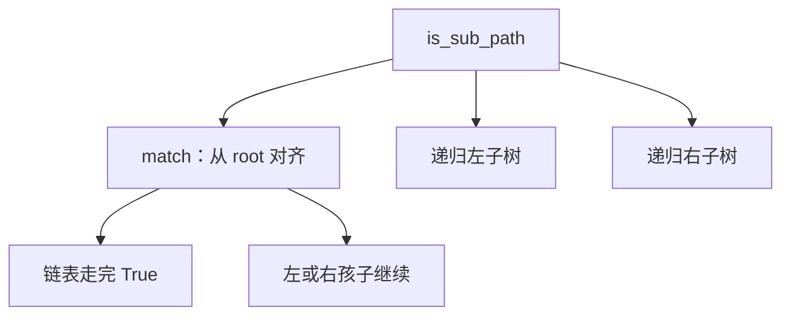

## Q
**LC 1367 二叉树中的链表**｜Medium

给链表头 `head` 和二叉树根 `root`。若链表的所有结点能按顺序对应树中一条自上而下的路径（路径不必从根开始、不必到叶），返回 `true`。

## A
**一句话。** 双层递归：`isSubPath` 枚举路径的起点（根、左子树、右子树），`match` 从某个起点向下逐个对比链表结点。

**图解。** 外层决定「从哪个树结点开始」，内层沿着树向下和链表同步前进，链表走完即匹配成功。



```python
def is_sub_path(head, root):
    def match(l, t):                 # 从 t 向下能否匹配完整条链表
        if not l:
            return True
        if not t or t.val != l.val:
            return False
        return (match(l.next, t.left)
                or match(l.next, t.right))
    if not root:
        return False
    return (match(head, root)        # 从 root 开始匹配
            or is_sub_path(head, root.left)
            or is_sub_path(head, root.right))
```

**复杂度。** 时间 `O(n · m)`，空间 `O(h + m)`（`n` 树结点数，`m` 链表长）。

**易错点。**
- 匹配失败后在 `match` 里换起点：`match` 只负责从当前起点向下对齐，换起点由外层负责。
- 链表走完才判断树空：顺序要先判链表空（成功），再判树空或值不等（失败）。
- 把路径当成必须到叶子：路径可以在任意结点结束。

**追问。**
- 能更快吗？：把链表转成数组，用 KMP 的失配数组在树上 DFS，`O(n + m)`。
- 和 LC 572 另一棵树的子树有何区别？：那题要匹配整棵子树，这题只匹配一条向下路径。

**同模式。** LC 572 另一个树的子树、LC 437 路径总和 III、LC 112 路径总和
