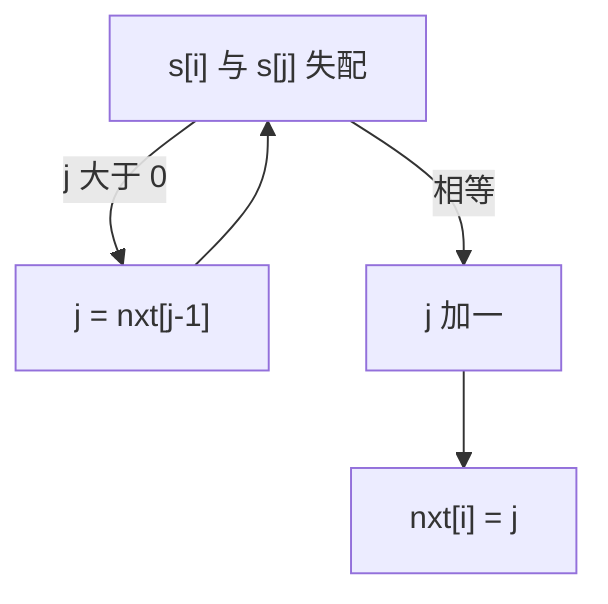

## Q
**LC 1392 最长快乐前缀**｜Hard

字符串 `s` 的「快乐前缀」是既是前缀又是后缀（不含 `s` 自身）的非空子串。返回最长的快乐前缀，没有返回 `""`。

## A
**一句话。** KMP 的失配数组：`nxt[i]` 是 `s[:i+1]` 的最长相等真前后缀，答案就是 `s[:nxt[-1]]`。

**图解。** `s = ababab`：扫描时已匹配长度 `j` 遇到失配就退到 `nxt[j-1]`，最终 `nxt = [0,0,1,2,3,4]`，最长快乐前缀长 4。



```python
def longest_prefix(s):
    n = len(s)
    nxt = [0] * n          # nxt[i]：s[:i+1] 最长相等真前后缀
    j = 0
    for i in range(1, n):
        while j and s[i] != s[j]:
            j = nxt[j - 1]           # 失配：退到更短的前后缀
        if s[i] == s[j]:
            j += 1
        nxt[i] = j
    return s[:nxt[-1]]
```

**复杂度。** 时间 `O(n)`，空间 `O(n)`。

**易错点。**
- 失配时 `j -= 1`：要跳到 `nxt[j - 1]`，一步一步减会退化成 `O(n²)`。
- 用 `if` 代替 `while` 回退：失配后可能要连续回退多次。
- 允许前缀等于整个串：快乐前缀不含 `s` 自身，失配数组里的值天然小于 `i + 1`。

**追问。**
- 为什么 `nxt[-1]` 就是答案？：它的定义正是整个串最长的相等真前后缀。
- 字符串哈希怎么做？：枚举前缀长度，比较前缀与后缀的哈希，`O(n)` 但有碰撞风险。

**同模式。** LC 28 找出字符串中第一个匹配项的下标、LC 459 重复的子字符串、LC 214 最短回文串
