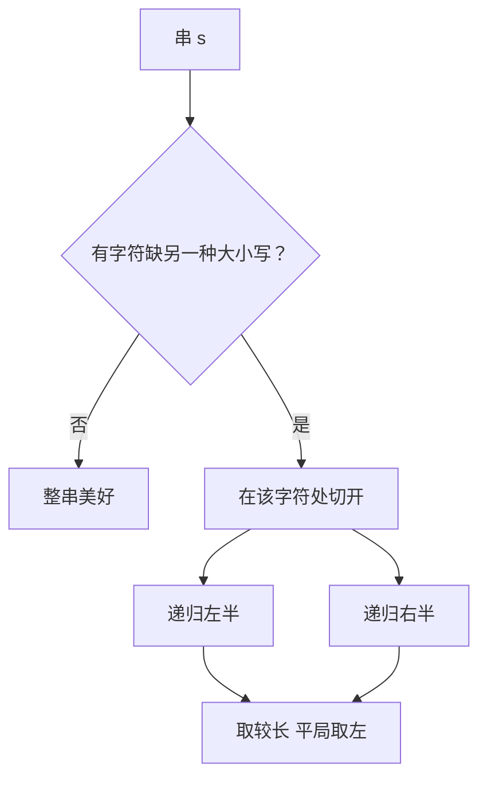

## Q
**LC 1763 最长的美好子字符串**｜Easy

字符串 `s`，若某个子串里每个字母的大写和小写形式都出现，它就是"美好"子串。求最长的美好子串，有多个返回最早出现的，没有返回空串。

## A
**一句话。** 分治：只要有一个字符的另一种大小写不在串中，它就不可能在任何美好子串里，按它切开，递归左右两半。



```python
def longest_nice_substring(s):
    chars = set(s)
    for i, c in enumerate(s):
        if c.swapcase() not in chars:     # c 不能出现在答案里
            left = longest_nice_substring(s[:i])
            right = longest_nice_substring(s[i + 1:])
            return left if len(left) >= len(right) \
                else right
    return s                              # 所有字符都成对，整串美好
```

**复杂度。** 时间 `O(n · 52)` 到 `O(n²)`，空间 `O(n)`。

**易错点。**
- 平局取右边：要求最早出现的，长度相等时取左边（`>=`）。
- 空串当成无效：空串递归返回 `""`，刚好是"没有"的答案。

**追问。**
- 能线性吗？：枚举窗口内不同字母数 `t`，滑动窗口要求每个字母大小写齐全，复杂度 `O(26n)`。

**同模式。** LC 395 至少有 K 个重复字符的最长子串、LC 340 至多包含 K 个不同字符的最长子串、LC 424 替换后的最长重复字符、LC 3 无重复字符的最长子串
