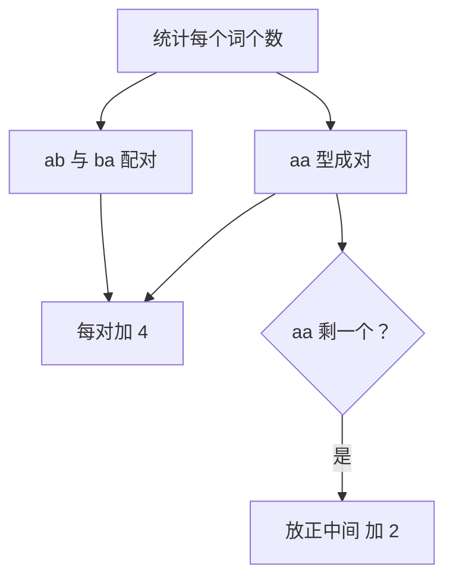

## Q
**LC 2131 连接两字母单词得到的最长回文串**｜Medium

字符串数组 `words`，每个字符串长度为 `2`。选出若干个并按任意顺序拼接，使结果是回文。求能得到的最长回文串长度，不能得到返回 `0`。

## A
**一句话。** 两类词：`ab` 和 `ba` 成对放两侧；`aa` 型自己是回文，成对放两侧，剩下的一个（若有）放正中间，只能放一个。



```python
def longest_palindrome(words):
    cnt = Counter(words)
    ans = 0
    mid = False
    for w, c in cnt.items():
        if w[0] == w[1]:                   # aa 型
            ans += c // 2 * 4
            mid = mid or c % 2 == 1        # 剩一个可放中间
        elif w[0] < w[1]:                  # ab 与 ba 只统计一次
            ans += min(c, cnt[w[::-1]]) * 4
    return ans + (2 if mid else 0)
```

**复杂度。** 时间 `O(n)`，空间 `O(n)`。

**易错点。**
- `ab` 和 `ba` 各统计一次：用 `w[0] < w[1]` 限定，否则长度翻倍。
- 中间位放多个 `aa`：中间只有一个位置，只加一次 `2`。

**追问。**
- 为什么 `cnt[w[::-1]]` 不会往 `Counter` 里塞键？：`Counter` 对不存在的键只返回 `0`，不插入。

**同模式。** LC 409 最长回文串、LC 266 回文排列、LC 2384 最大回文数字、LC 1400 构造 K 个回文字符串
