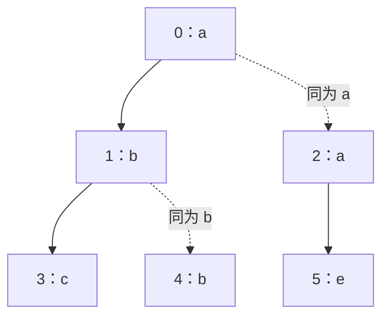

## Q
**LC 2246 相邻字符不同的最长路径**｜Hard

以 0 为根的树（`parent` 数组），每个点有一个字符。求相邻点字符都不同的最长路径包含的点数。

## A
**一句话。** 树形 DP 求直径：`dfs(u)` 返回从 `u` 往下的最长合法链；只有字符不同的孩子链能接上，在 `u` 处把最长的两条拼起来更新答案。

**图解。** 虚线两端字符相同，接不上；最长路径是 `3 → 1 → 0`，共 3 个点。



```python
def longest_path(parent, s):
    n = len(parent)
    children = [[] for _ in range(n)]
    for i in range(1, n):
        children[parent[i]].append(i)
    ans = 0

    def dfs(u):                # u 往下最长合法链的点数
        nonlocal ans
        best = 0               # 目前最长的一条孩子链
        for v in children[u]:
            d = dfs(v)         # 先递归：子树里的答案也要算
            if s[v] != s[u]:
                ans = max(ans, best + d + 1)  # 两条拼起来
                best = max(best, d)
        ans = max(ans, best + 1)
        return best + 1

    dfs(0)
    return ans
```

**复杂度。** 时间 `O(n)`，空间 `O(n)`。

**易错点。**
- 字符相同就不递归：那个孩子的子树里仍可能有更长的路径，必须先递归再判断能否接上。
- 返回值用边数而答案要点数：统一用点数，拼接时 `best + d + 1`。

**追问。**
- 和二叉树直径的区别？：多叉树要在遍历孩子时维护最长链，边遍历边和当前最长拼接，不必排序。
- 树很深？：`n = 10^5` 的链会让递归太深，按 BFS 序逆序处理即可迭代。

**同模式。** LC 543 二叉树的直径、LC 124 二叉树中的最大路径和、LC 687 最长同值路径
