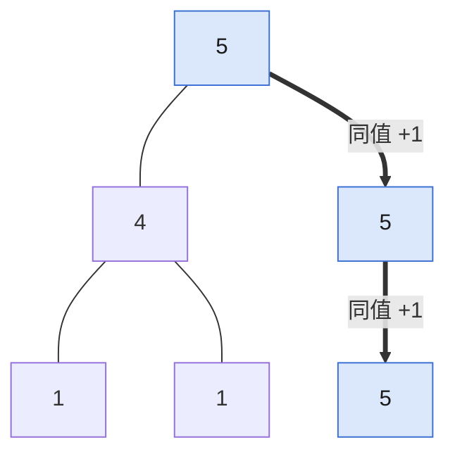

## Q
**LC 687 最长同值路径**｜Medium

给二叉树根节点，求最长的一条路径，路径上每个节点值都相同，路径可以不过根，长度按边数算。

## A
**一句话。** 后序递归返回「从当前节点往下的同值链节点数」，在每个节点把左右两条链相加更新答案（树的直径套路）。

**图解。** 值为 4 的左枝不参与，根与右边两个 5 连成一条，路径长 2。



```python
def longest_univalue_path(root):
    ans = 0
    def dfs(node):                  # 从 node 往下的同值链节点数
        nonlocal ans
        if not node:
            return 0
        l, r = dfs(node.left), dfs(node.right)
        if node.left and node.left.val != node.val:
            l = 0                   # 值不同，链断开
        if node.right and node.right.val != node.val:
            r = 0
        ans = max(ans, l + r)       # 在 node 处拐弯，l+r 条边
        return max(l, r) + 1        # 向上只能带一条
    dfs(root)
    return ans
```

**复杂度。** 时间 `O(n)`，空间 `O(h)`。

**易错点。**
- 不比孩子的值就把链接上：左边是 `4` 也会被算进链，值不同必须清零。
- 返回 `l + r`：向上走的路径只能带一侧，拐弯的两侧相加只用来更新答案。
- 按节点数而非边数计：单个节点的路径长是 `0`。

**追问。**
- 要路径和最大而不是最长？：同一套路，返回值换成单侧最大和，见最大路径和。
- 孩子值相同但根不同呢？：链在根处断开，`l`、`r` 记 0，但孩子子树里的答案已更新。

**同模式。** LC 124 二叉树中的最大路径和、LC 543 二叉树的直径、LC 298 二叉树最长连续序列
