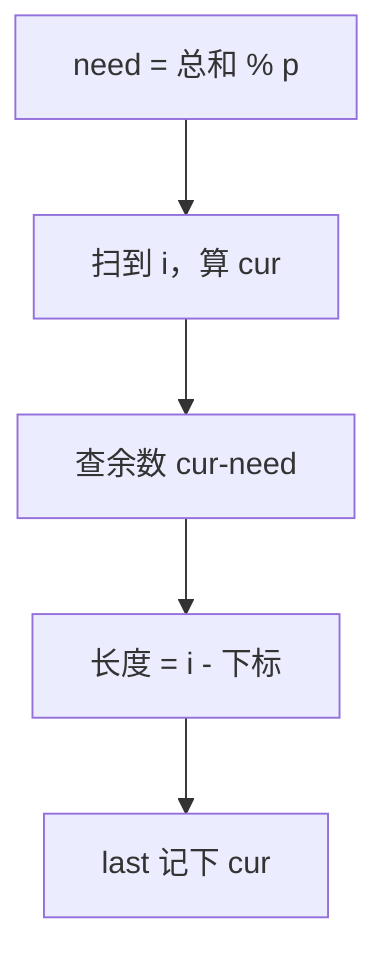

## Q
**LC 1590 使数组和能被 P 整除**｜Medium

正整数数组 `nums` 和整数 `p`。移除一个最短的子数组（可为空，但不能是整个数组），使剩余元素之和能被 `p` 整除。返回最短长度，做不到返回 `-1`。

## A
**一句话。** 总和模 `p` 余 `need`，就要删掉一段和模 `p` 也为 `need` 的子数组；用前缀和余数的哈希表找最近的 `cur - need`。



```python
def min_subarray(nums, p):
    need = sum(nums) % p
    if need == 0:
        return 0
    last = {0: -1}               # 前缀余数 -> 最近下标
    cur, ans = 0, len(nums)
    for i, x in enumerate(nums):
        cur = (cur + x) % p
        j = last.get((cur - need) % p)
        if j is not None:
            ans = min(ans, i - j)
        last[cur] = i            # 先查再存，保证最近
    return -1 if ans == len(nums) else ans
```

**复杂度。** 时间 `O(n)`，空间 `O(n)`。

**易错点。**
- 先存 `last[cur]` 再查：`need` 为 `0` 的特例外，会把空段当成答案。
- 答案等于 `n`：删掉整个数组不允许，要返回 `-1`。
- `(cur - need)` 不取模：Python 之外的语言里余数会出现负数。

**追问。**
- 为什么存最近下标？：子数组越短越好，右端点固定时左端点越靠右越短。

**同模式。** LC 974 和可被 K 整除的子数组、LC 560 和为 K 的子数组、LC 523 连续的子数组和、LC 525 连续数组
