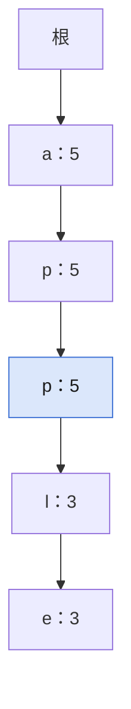

## Q
**LC 677 键值映射**｜Medium

设计 `MapSum`：`insert(key, val)` 插入键值对（键已存在则覆盖旧值），`sum(prefix)` 返回所有以 `prefix` 为前缀的键的值之和。

## A
**一句话。** 前缀树（Trie）的每个节点存「经过它的所有键的值之和」；插入时只加新旧值的差量，查询沿前缀走到节点直接读和。

**图解。** 先插 `apple=3`、再插 `app=2`：沿途节点累计，`ap` 的和是 5，`appl` 的和还是 3。



```python
class MapSum:
    def __init__(self):
        self.root = {}               # 字符 -> 子节点，'#' -> 和
        self.val = {}                    # 键 -> 当前值

    def insert(self, key, val):
        delta = val - self.val.get(key, 0)   # 覆盖旧值：只加差量
        self.val[key] = val
        node = self.root
        for c in key:
            node = node.setdefault(c, {})
            node['#'] = node.get('#', 0) + delta

    def sum(self, prefix):
        node = self.root
        for c in prefix:
            if c not in node:
                return 0
            node = node[c]
        return node.get('#', 0)
```

**复杂度。** 时间每次 `O(键长)`，空间 `O(键字符总数)`。

**易错点。**
- 覆盖旧键时直接再加新值：旧值仍在和里，要加 `新值 - 旧值`。
- `sum` 时再遍历子树求和：慢，节点上预存和，查询才是 `O(前缀长)`。
- 前缀不存在时没判断：沿着缺失的字符走会报错，要返回 `0`。

**追问。**
- 不用 Trie 能做吗？：哈希表存全部键，`sum` 时逐个检查前缀，`O(键数·前缀长)`，简单但慢。
- 要支持删除键？：把差量设成负的旧值，沿路径减去即可。

**同模式。** LC 208 实现 Trie (前缀树)、LC 211 添加与搜索单词 - 数据结构设计、LC 648 单词替换
