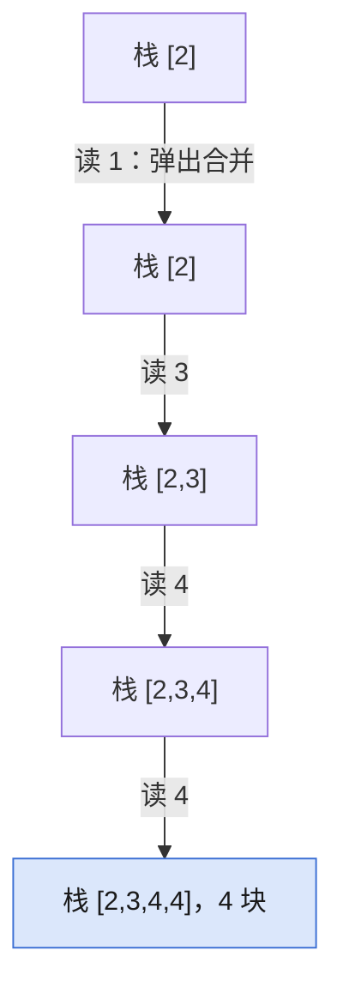

## Q
**LC 768 最多能完成排序的块 II**｜Hard

把数组 `arr`（可含重复值）分成若干连续块，每块各自排序后再拼接，结果要等于整个数组排序后的样子。返回最多能分成多少块。

## A
**一句话。** 单调栈存每块的最大值：新元素比栈顶小就把这些块并入同一块，块最大值取被弹出者的最大，栈大小就是块数。

**图解。** `[2,1,3,4,4]`：`1` 弹出栈顶 `2`，两块合并成最大值 `2`；`3`、`4`、`4` 都不小于栈顶，各自成块，栈内共 4 块。



```python
def max_chunks_to_sorted(arr):
    st = []                          # 每块的最大值，单调不降
    for x in arr:
        mx = x
        while st and st[-1] > x:     # 前面块的最大值比 x 大：并入
            mx = max(mx, st.pop())
        st.append(mx)                # 合并后的块，以最大值代表
    return len(st)
```

**复杂度。** 时间 `O(n)`，空间 `O(n)`。

**易错点。**
- 弹出条件写成 `>=`：相等的值可以分开，会少分块。
- 合并后压回 `x`：应压回被弹出者的最大值，否则栈不再单调。

**追问。**
- 元素是 `0..n-1` 的排列（LC 769）？：`max(arr[:i+1]) == i` 的位置个数，不用栈。
- 还有不用栈的写法吗？：前缀最大 ≤ 后缀最小的位置就是一个切点，数切点个数 + 1。

**同模式。** LC 769 最多能完成排序的块、LC 581 最短无序连续子数组、LC 739 每日温度
