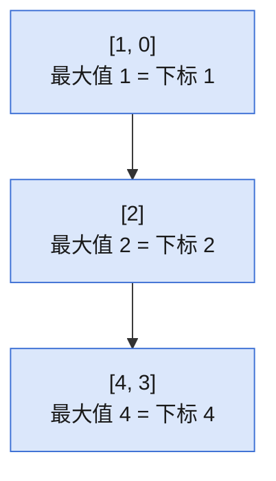

## Q
**LC 769 最多能完成排序的块**｜Medium

`arr` 是 `0..n-1` 的一个排列。把它切成若干连续的块，分别对每块排序后再按原顺序拼起来，结果要是升序。最多能切成几块？

## A
**一句话。** 排列里前 `i + 1` 个数的最大值恰好等于 `i`，说明它们正好是 `0..i`，可以在这里切一刀。

**图解。** `[1,0,2,4,3]`：前缀最大值依次为 1、1、2、4、4，只有下标 1、2、4 处最大值等于下标，所以在这些位置切，共 3 块。



```python
def max_chunks_to_sorted(arr):
    mx = chunks = 0
    for i, x in enumerate(arr):
        mx = max(mx, x)          # 前缀最大值
        if mx == i:              # 前 i+1 个数正好是 0..i
            chunks += 1
    return chunks
```

**复杂度。** 时间 `O(n)`，空间 `O(1)`。

**易错点。**
- 比较 `mx` 和 `x`：要比的是前缀最大值与下标。
- 把它套到有重复值的数组：重复值时不能用「最大值等于下标」，要换成 LC 768 的单调栈。

**追问。**
- 为什么最大值等于下标就能切？：前 `i + 1` 个数互不相同、都在 `0..i` 内，必然是 `0..i` 的一个排列，排好序后正好占据前 `i + 1` 位。
- 数组不是排列怎么办？：用单调栈维护每块的最大值，新数弹出所有比它大的块并合并，栈的大小就是答案。

**同模式。** LC 768 最多能完成排序的块 II、LC 739 每日温度、LC 581 最短无序连续子数组
