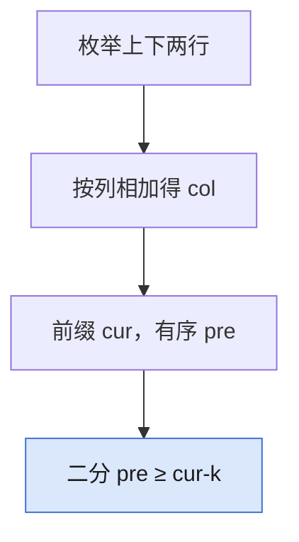

## Q
**LC 363 矩形区域不超过 K 的最大数值和**｜Hard

给 `m×n` 的整数矩阵 `matrix` 和整数 `k`，返回其中和不超过 `k` 的矩形区域的最大和。

## A
**一句话。** 固定上下两行，把中间各行按列加成一维数组，问题变成「一维数组里和不超过 `k` 的最大子数组」：用有序前缀和，对每个 `cur` 二分找最小的 `pre ≥ cur - k`。

**图解。** 枚举上下边界，压成一维，再在一维上二分。



```python
def max_sum_submatrix(matrix, k):
    m, n = len(matrix), len(matrix[0])
    ans = float('-inf')
    for top in range(m):
        col = [0] * n                # 上下行之间按列相加
        for bottom in range(top, m):
            for j in range(n):
                col[j] += matrix[bottom][j]
            pre, cur = [0], 0            # pre：有序前缀和
            for x in col:
                cur += x
                i = bisect_left(pre, cur - k)  # >= cur-k
                if i < len(pre):
                    ans = max(ans, cur - pre[i])
                insort(pre, cur)
    return ans
```

**复杂度。** 时间 `O(m²·n·log n)`（`insort` 为 `O(n)` 时实际略高），空间 `O(n)`。

**易错点。**
- 前缀和列表没放初始的 `0`：以第一列开头的子数组就漏了。
- 二分写成找 `<= cur - k`：要最大的差 `cur - pre` 且不超过 `k`，所以找最小的 `pre ≥ cur - k`。
- 行数多于列数时仍枚举行对：应枚举较小的维度，复杂度才是 `O(min²·max·log)`。

**追问。**
- 没有 `k` 的限制时？：就是二维最大子矩阵和，一维退化为 Kadane，`O(m²·n)`。
- 为什么要有序结构？：要在「之前的前缀和」里找最接近 `cur - k` 的一个，是典型的有序集合查询。

**同模式。** LC 1074 元素和为目标值的子矩阵数量、LC 560 和为 K 的子数组、LC 53 最大子数组和、LC 85 最大矩形
