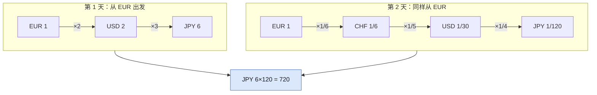

## Q
**LC 3387 两天自由外汇交易后的最大货币数**｜Medium

你有 `1.0` 个 `initialCurrency`。第 1 天可按 `pairs1/rates1` 任意次兑换，第 2 天按 `pairs2/rates2`；每对 `[a,b]` 汇率 `r` 也可反向按 `1/r` 兑换。求两天后最多有多少个 `initialCurrency`。

## A
**一句话。** 每天的汇率图无矛盾无环，两种货币间的换算比唯一，所以每天 DFS 一遍算出 1 个初始货币能换多少个 `c`，答案取 `day1[c] / day2[c]` 的最大值。

**图解。** 两天各从初始货币 DFS 一遍算出比率，第 2 天把 `c` 换回去要除以 `d2[c]`。



```python
def maxAmount(src, pairs1, rates1, pairs2, rates2):
    def rates_from(pairs, rates):
        g = defaultdict(list)
        for (a, b), r in zip(pairs, rates):
            g[a].append((b, r))        # 1 个 a 换 r 个 b
            g[b].append((a, 1 / r))    # 反向边
        amt = {src: 1.0}               # 1 个初始货币能换几个 c

        def dfs(u):
            for v, r in g[u]:
                if v not in amt:       # 无环无矛盾：首次到达即可
                    amt[v] = amt[u] * r
                    dfs(v)
        dfs(src)
        return amt

    d1 = rates_from(pairs1, rates1)
    d2 = rates_from(pairs2, rates2)
    # 第 2 天把 c 换回初始货币的比率是 1 / d2[c]
    return max(a / d2[c] for c, a in d1.items() if c in d2)
```

**复杂度。** 时间 `O(n + m)`，空间 `O(n + m)`。

**易错点。**
- 漏掉反向边 `1/r`：示例 1 第 2 天只有 `JPY→USD→CHF→EUR`，从 `EUR` 正向走不出去，得 `1.0`，应为 `720.0`。
- 换回比率写成 `d2[c]` 而不是 `1 / d2[c]`：示例 2 得 `54.0`，应为 `1.5`。
- 不检查 `c in d2`：第 2 天图里没有的货币换不回来，必须排除。

**追问。**
- 图可能有矛盾或套利环？：每天改成 Bellman-Ford 式松弛，状态是手里每种货币的最大数量，轮数要设上限。
- 扩展到 `d` 天？：上一天的结果作为下一天的初值，逐天松弛。

**同模式。** LC 399 除法求值、LC 1514 概率最大的路径、LC 787 K 站中转内最便宜的航班、LC 743 网络延迟时间
