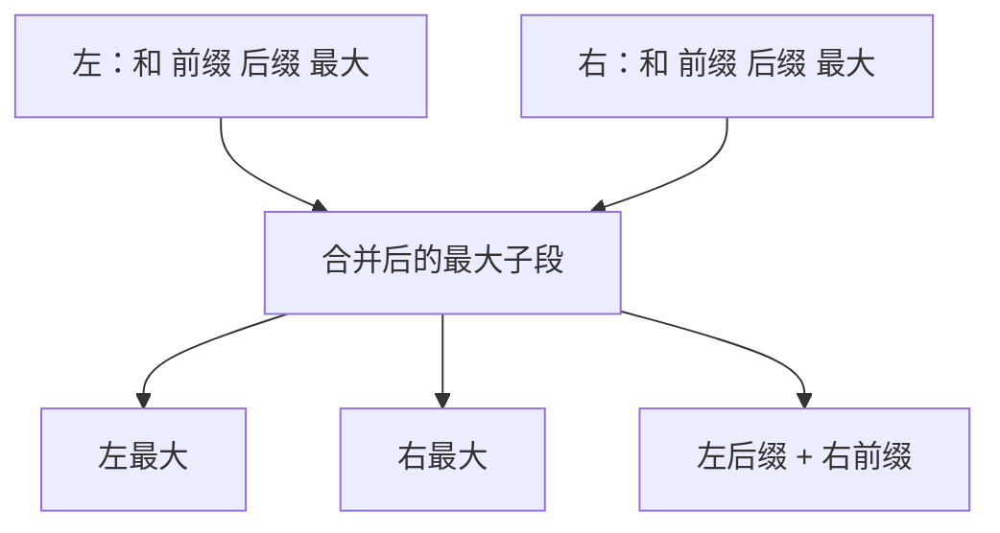

## Q
**LC 3410 删除所有值为某个元素后的最大子数组和**｜Hard

整数数组 `nums`，至多做一次操作：选一个值 `X`，删掉所有等于 `X` 的元素（删后数组非空）。求所有可能结果中的最大子数组和。

## A
**一句话。** 删掉 `X` 等于把它们改成 0（全负的情形单独处理）；线段树每个结点存「和、最大前缀、最大后缀、最大子段」，对每个负数值 `X` 把它的位置单点改 0、读根、再改回，总共 `n` 次单点修改。

**图解。** 两段合并时，最大子段要么在左、要么在右、要么横跨中线（左后缀 + 右前缀）。



```python
def max_subarray_sum(nums):
    if max(nums) < 0:
        return max(nums)       # 全负：删谁都不会更好
    n, size = len(nums), 1
    while size < n:
        size *= 2

    def merge(a, b):           # (和, 最大前缀, 最大后缀, 最大子段)
        return (a[0] + b[0],
                max(a[1], a[0] + b[1]),
                max(b[2], b[0] + a[2]),
                max(a[3], b[3], a[2] + b[1]))

    t = [(0, -inf, -inf, -inf)] * (2 * size)
    for i, x in enumerate(nums):
        t[size + i] = (x, x, x, x)
    for i in range(size - 1, 0, -1):
        t[i] = merge(t[2 * i], t[2 * i + 1])

    def update(i, x):          # 单点改值，沿路往上重算
        i += size
        t[i] = (x, x, x, x)
        while i > 1:
            i //= 2
            t[i] = merge(t[2 * i], t[2 * i + 1])

    pos = defaultdict(list)
    for i, x in enumerate(nums):
        pos[x].append(i)
    ans = t[1][3]              # 不删
    for x, idx in pos.items():
        if x >= 0:
            continue           # 删非负数不会更好
        for i in idx:
            update(i, 0)       # 删掉 = 当成 0
        ans = max(ans, t[1][3])
        for i in idx:
            update(i, x)       # 还原
    return ans
```

**复杂度。** 时间 `O(n log n)`，空间 `O(n)`。

**易错点。**
- 不处理全负数组：改成 0 后会得到「空子数组」的 0，而正确答案是最大的那个负数。
- 每个 `X` 重建整棵树：`O(n)` 次重建是 `O(n²)`，要单点改再还原。

**追问。**
- 为什么非全负时改 0 不会出错？：只有 0 构成的子段和为 0，而原数组有非负数，不删时答案已 `>= 0`。
- 不用线段树？：DP 加前缀和：对每个值记录「上次出现时的最优状态」，`O(n)`，但推导更绕。

**同模式。** LC 53 最大子数组和、LC 918 环形子数组的最大和、LC 1186 删除一次得到子数组最大和
