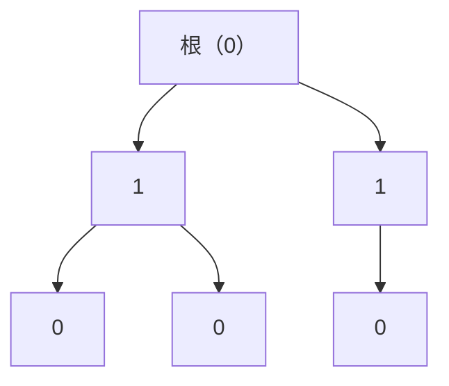

## Q
**LC 3373 连接两棵树后最大目标节点数目 II**｜Hard

两棵树（各 `<= 10^5` 个点）。与 `u` 距离为偶数的点（含自己）是 `u` 的目标节点。对第一棵树的每个点 `i`，在两棵树间任连一条边（各问独立），求 `i` 的目标节点数的最大值。

## A
**一句话。** 树是二分图，距离奇偶只看两点同色否：`i` 在树 1 的目标数就是与它同色的点数；新边让树 2 的点距离多 1，所以树 2 里取颜色较多的那一类（连到与之异色的点上），答案是两部分相加。

**图解。** 按深度奇偶染色，同色距离为偶数；新边把树 2 的奇偶翻转，树 2 一侧永远取两种颜色中点数较多的那种。



```python
def max_target_nodes(edges1, edges2):
    def color(edges):
        g = [[] for _ in range(len(edges) + 1)]
        for a, b in edges:
            g[a].append(b)
            g[b].append(a)
        col = [0] * len(g)

        def dfs(u, fa, c):             # 按深度奇偶染色
            col[u] = c
            for v in g[u]:
                if v != fa:
                    dfs(v, u, c ^ 1)

        dfs(0, -1, 0)
        return col

    c1, c2 = color(edges1), color(edges2)
    same = [c1.count(0), c1.count(1)]
    best = max(c2.count(0), c2.count(1))   # 树 2 取多的一色
    return [same[c] + best for c in c1]
```

**复杂度。** 时间 `O(n + m)`，空间 `O(n + m)`。

**易错点。**
- 树 2 用与 `i` 相同的颜色：新边多走一步，要取与连接点异色的那一类，不是同色类。
- 对每个 `i` 重新数树 2：这一部分与 `i` 无关，只数一次取最大。

**追问。**
- 为什么树 2 取多的颜色总能达到？：连接点可任选，选到这一色的对面颜色的点即可。
- 树很深会爆递归吗？：`10^5` 的链会，用 BFS 按层染色即可，结果相同。

**同模式。** LC 785 判断二分图、LC 3372 连接两棵树后最大目标节点数目 I、LC 863 二叉树中所有距离为 K 的结点
