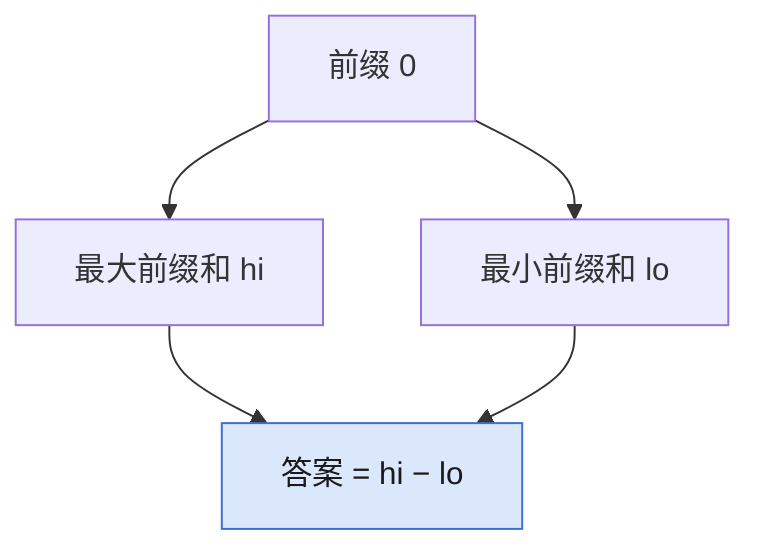

## Q
**LC 1749 任意子数组和的绝对值的最大值**｜Medium

整数数组 `nums`，子数组可以为空（和为 0）。求任意子数组的和的绝对值的最大值。

## A
**一句话。** 子数组和是两个前缀和之差，绝对值最大就是所有前缀和（含空前缀 0）的最大值减最小值。

**图解。** 前缀和折线上，最高点与最低点的落差就是答案，谁先谁后都无所谓（先后只决定正负）。



```python
def max_absolute_sum(nums):
    s = hi = lo = 0              # 空前缀 0 也要参与比较
    for x in nums:
        s += x
        hi = max(hi, s)
        lo = min(lo, s)
    return hi - lo
```

**复杂度。** 时间 `O(n)`，空间 `O(1)`。

**易错点。**
- `hi`、`lo` 初值取第一个前缀和：漏掉空前缀 0，全正数组会得到错误结果。
- 分别做两遍最大子数组和再取绝对值：可行，但这个前缀和写法一遍就够。

**追问。**
- 为什么先后顺序不影响？：`P[j] - P[i]` 若为负，取绝对值相当于交换 `i`、`j`，最大落差不变。
- 用 Kadane 怎么做？：一遍同时维护「以当前位置结尾的最大和」和「最小和」，取绝对值最大。

**同模式。** LC 53 最大子数组和、LC 1186 删除一次得到子数组最大和、LC 918 环形子数组的最大和、LC 560 和为 K 的子数组
