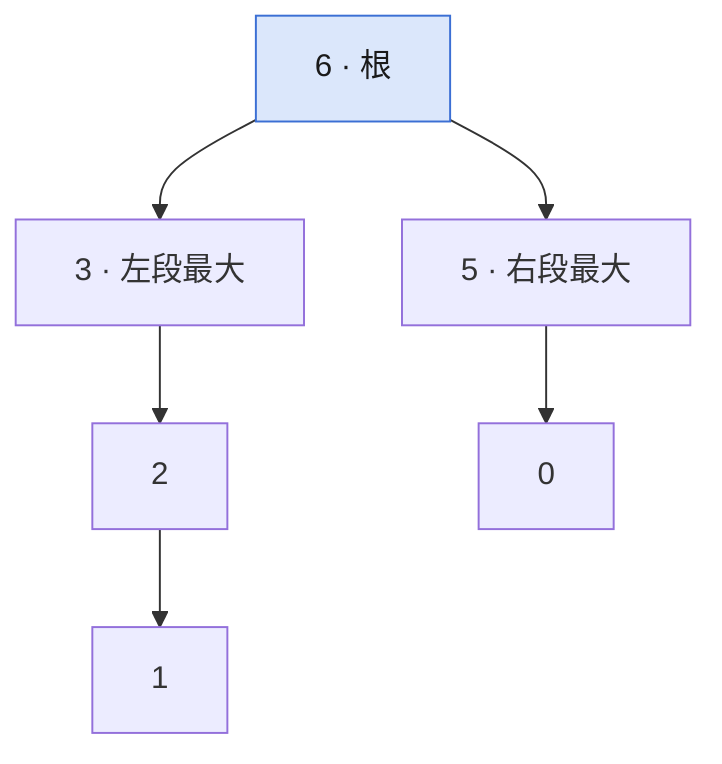

## Q
**LC 654 最大二叉树**｜Medium

数组 `nums` 的值互不相同。构造二叉树：根是最大值，左子树由最大值左边的部分递归构造，右子树由右边部分构造。返回根。

## A
**一句话。** 找最大值的位置作根，左右两段各自递归；想要线性时间就用单调递减栈。

**图解。** `[3,2,1,6,0,5]`：最大值 `6` 把数组切成 `[3,2,1]` 和 `[0,5]`，每段再取最大值。



```python
def max_tree(nums):
    if not nums:
        return None
    i = nums.index(max(nums))        # 最大值作根
    return TreeNode(nums[i],
                    max_tree(nums[:i]),
                    max_tree(nums[i + 1:]))
```

**复杂度。** 时间 `O(n^2)`（最坏是有序数组），空间 `O(n)`；单调栈把时间降到 `O(n)`。

**易错点。**
- 切片含了最大值：`nums[:i + 1]` 会让递归永远不收敛。
- 把「左边」当成原数组前半：左子树只来自最大值左侧的连续段。

**追问。**
- 怎样做到 `O(n)`？：从左到右维护递减栈；新值先弹出所有更小的，弹出的最后一个成为它的左孩子，它自己再成为栈顶的右孩子。
- 为什么栈能替代递归？：每个结点的父亲是左右两侧第一个比它大的数中较小的那个，单调栈一次扫描就能找到。

**同模式。** LC 105 从前序与中序遍历序列构造二叉树、LC 108 将有序数组转换为二叉搜索树、LC 1008 前序遍历构造二叉搜索树、LC 889 从前序与后序遍历序列构造二叉树
