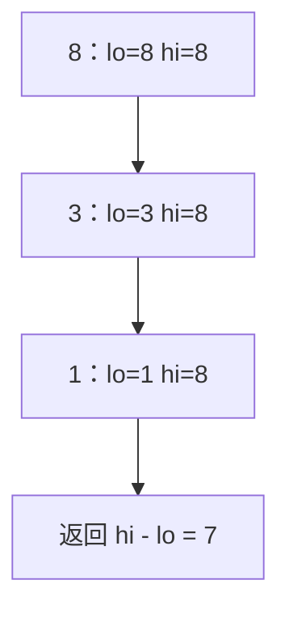

## Q
**LC 1026 节点与其祖先之间的最大差值**｜Medium

给二叉树根结点，求最大的 `|a.val - b.val|`，其中 `a` 是 `b` 的祖先。

## A
**一句话。** 自顶向下 DFS，带着路径上已见的最小值和最大值；走到空结点时，`最大 - 最小` 就是这条路径上的最大差。

**图解。** 路径 `8 → 3 → 1` 一路更新 `lo`、`hi`；每个结点只与它上方的祖先比较，所以答案是路径极差，到空结点返回。



```python
def max_ancestor_diff(root):
    def dfs(node, lo, hi):
        if not node:
            return hi - lo               # 路径走完：极差
        lo = min(lo, node.val)
        hi = max(hi, node.val)
        return max(dfs(node.left, lo, hi),
                   dfs(node.right, lo, hi))
    return dfs(root, root.val, root.val)
```

**复杂度。** 时间 `O(n)`，空间 `O(h)`。

**易错点。**
- 只比较父子：差值最大的可能是隔了好几层的祖先，要带路径最值而不是只带父结点值。
- 用结点的子树最值：那样会把兄弟子树的结点也当成祖先后代，应沿路径向下传。

**追问。**
- 自底向上能做吗？：返回子树的 `(min, max)`，在每个结点用 `|val - min|`、`|val - max|` 更新答案。
- 为什么只需要极差？：路径上某结点与祖先的最大差一定出现在祖先中的最小或最大值上。

**同模式。** LC 1448 统计二叉树中好节点的数目、LC 124 二叉树中的最大路径和、LC 543 二叉树的直径
