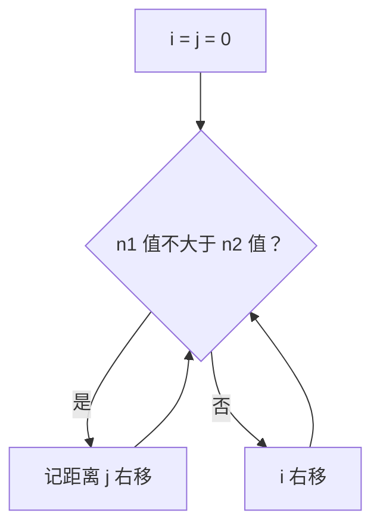

## Q
**LC 1855 下标对中的最大距离**｜Medium

两个非递增整数数组 `nums1`、`nums2`。下标对 `(i, j)` 有效当且仅当 `i <= j` 且 `nums1[i] <= nums2[j]`，距离为 `j - i`。求最大距离，没有有效对返回 `0`。

## A
**一句话。** 双指针：`nums1[i] <= nums2[j]` 时记录距离并让 `j` 右移（想拉得更远），否则 `i` 右移（当前 `nums1[i]` 太大）。



```python
def max_distance(nums1, nums2):
    i = j = ans = 0
    while i < len(nums1) and j < len(nums2):
        if nums1[i] <= nums2[j]:
            ans = max(ans, j - i)     # j 往右只会更远
            j += 1
        else:
            i += 1                    # nums1[i] 太大，换小的
    return ans
```

**复杂度。** 时间 `O(m + n)`，空间 `O(1)`。

**易错点。**
- 成立时移动 `i`：会错过更远的 `j`，应该让 `j` 向右试探。
- `ans` 初值取负数：没有有效对时答案是 `0`。

**追问。**
- 不想用双指针？：对每个 `i` 在 `nums2` 上二分找最右的 `j`，`O(m log n)`。

**同模式。** LC 2300 咒语和药水的成功对数、LC 2563 统计公平数对的数目、LC 315 计算右侧小于当前元素的个数
