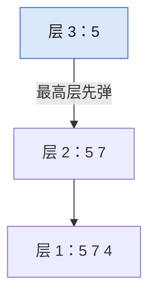

## Q
**LC 895 最大频率栈**｜Hard

设计 `FreqStack`：`push(val)` 压入一个整数，`pop()` 弹出并返回出现次数最多的元素；次数相同则弹最靠近栈顶（最后压入）的那个。

## A
**一句话。** 按「出现次数」分层，第 `f` 层是一个栈，存所有出现过至少 `f` 次的值在第 `f` 次出现时的压入顺序；弹最高层的栈顶即可。

**图解。** 依次压入 `5 7 5 7 4 5`，弹出顺序是 `5 7 5 4 7 5`。



```python
class FreqStack:
    def __init__(self):
        self.cnt = defaultdict(int)      # 值 -> 次数
        self.group = defaultdict(list)   # 次数 -> 栈
        self.mx = 0                      # 当前最高层

    def push(self, val):
        self.cnt[val] += 1
        f = self.cnt[val]
        self.mx = max(self.mx, f)
        self.group[f].append(val)        # 只进第 f 层

    def pop(self):
        val = self.group[self.mx].pop()
        self.cnt[val] -= 1               # 它在更低层的记录仍在
        if not self.group[self.mx]:
            self.mx -= 1
        return val
```

**复杂度。** 时间 `push`、`pop` 各 `O(1)`，空间 `O(n)`。

**易错点。**
- 弹出时把值从所有层删除：只删最高层那一份，低层的记录要留着，下次它的次数是 `f-1`。
- 最高层空了不降 `mx`：下次 `pop` 会对着空栈弹出报错。
- 同次数用堆而不分层：要比较「最后压入」的时间戳，分层栈省去了比较。

**追问。**
- 为什么 `mx -= 1` 就够？：每一层非空的值都来自更低一层的同一个值，所以相邻层不会跳空。
- 想用堆做呢？：堆元素 `(-次数, -压入序号, 值)`，`O(log n)`，思路直接但慢。

**同模式。** LC 432 全 O(1) 的数据结构、LC 716 最大栈、LC 155 最小栈、LC 460 LFU 缓存
