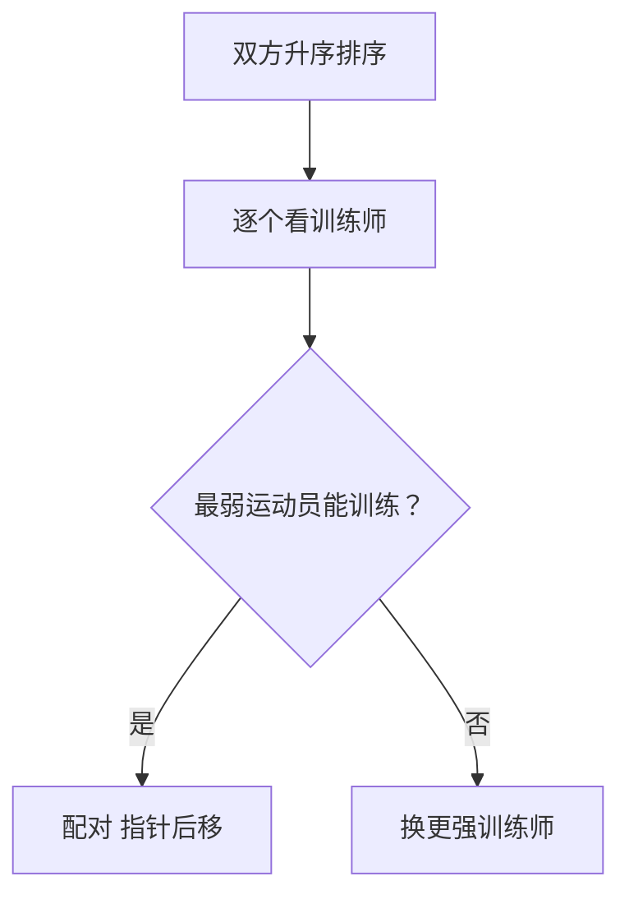

## Q
**LC 2410 运动员和训练师的最大匹配数**｜Medium

`players[i]` 是运动员能力值，`trainers[j]` 是训练师的训练能力值。运动员 `i` 能被训练师 `j` 训练，当且仅当 `players[i] <= trainers[j]`，一人只能配一人。求最大匹配数。

## A
**一句话。** 双方升序排序，对每个训练师，若最弱的未配对运动员能被他训练就配上，否则换更强的训练师。



```python
def match_players_and_trainers(players, trainers):
    players.sort()
    trainers.sort()
    i = 0
    for t in trainers:
        if i < len(players) and players[i] <= t:
            i += 1                  # 最弱的运动员配上这个训练师
    return i
```

**复杂度。** 时间 `O(n log n + m log m)`，空间 `O(1)`。

**易错点。**
- 用最强的运动员配最弱的合格训练师：反过来更好，让最弱的运动员先配，把强训练师留给后面。
- 忘了 `i` 的上界检查。

**追问。**
- 为什么贪心正确？：最弱的运动员能配的训练师集合最大，用掉任何一个合格训练师都不比用更强的差。

**同模式。** LC 455 分发饼干、LC 881 救生艇、LC 870 优势洗牌、LC 826 安排工作以达到最大收益
