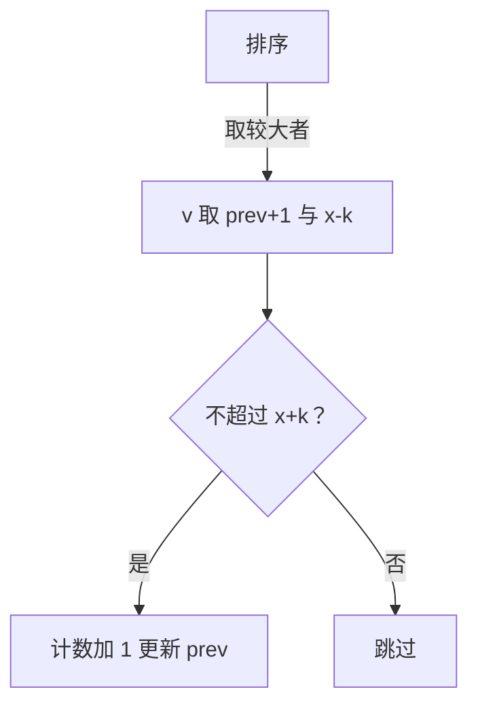

## Q
**LC 3397 执行操作后不同元素的最大数量**｜Medium

整数数组 `nums` 和整数 `k`。对每个元素最多做一次操作：加上 `[-k, k]` 内的任意整数。求操作后数组中不同元素的最大数量。

## A
**一句话。** 排序后贪心：每个数取"比上一个已选值大 `1` 的最小可达值"，`max(prev + 1, x - k)`，只要不超过 `x + k` 就选上并计数。



```python
def max_distinct_elements(nums, k):
    nums.sort()
    prev = -inf                       # 上一个选定的值
    ans = 0
    for x in nums:
        v = max(prev + 1, x - k)      # 在 [x-k, x+k] 内尽量取小
        if v <= x + k:
            ans += 1
            prev = v
    return ans
```

**复杂度。** 时间 `O(n log n)`，空间 `O(1)`。

**易错点。**
- 取区间中间值：越小越能给后面让路，要尽量取小。
- 取不到时仍更新 `prev`：此元素与某个已有值重复，`prev` 不变。

**追问。**
- 这和哪类问题相同？：LC 945 的"使数组唯一的最小增量"，都是排序后让每个数尽量小。

**同模式。** LC 945 使数组唯一的最小增量操作、LC 455 分发饼干、LC 1846 减小和重新排列数组后的最大元素
