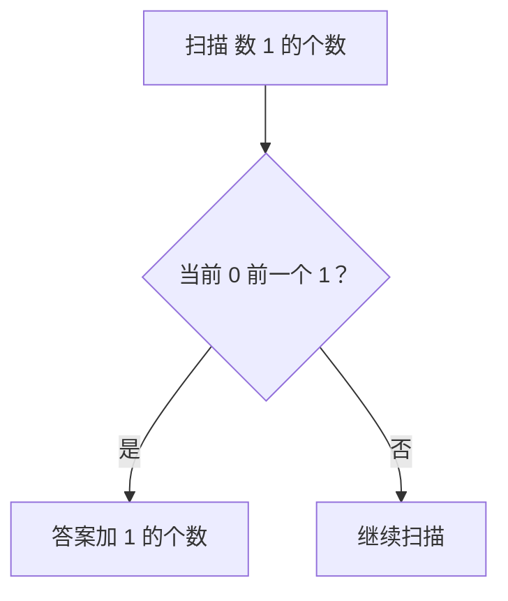

## Q
**LC 3228 将 1 移动到末尾的最大操作次数**｜Medium

二进制字符串 `s`。每次操作选下标 `i`，使 `s[i] == '1'` 且 `s[i + 1] == '0'`，把 `s[i]` 向右移动，直到遇到末尾或另一个 `1`。求最多能进行多少次操作。

## A
**一句话。** 每次移动的是一整块连续的 `1` 中最右边的那个；正确顺序下，每遇到一个"`1` 后紧跟着 `0`"的边界，前面的每个 `1` 都能各移动一次。



```python
def max_operations(s):
    ones = ans = 0
    for i, c in enumerate(s):
        if c == '1':
            ones += 1
        elif i and s[i - 1] == '1':    # 一段 0 的开头，前面所有 1 各一次
            ans += ones
    return ans
```

**复杂度。** 时间 `O(n)`，空间 `O(1)`。

**易错点。**
- 每个 `0` 都加：连续的 `0` 只在第一个处统计，后面的 `0` 已经被越过。
- 先移动左边的 `1`：会让后面的移动变少，应该先动靠右的。

**追问。**
- 为什么要先动右边的？：它们先到达末尾，让左边的 `1` 之后还能再多走一段。

**同模式。** LC 2938 区分黑球与白球、LC 283 移动零、LC 1653 使字符串平衡的最少删除次数
