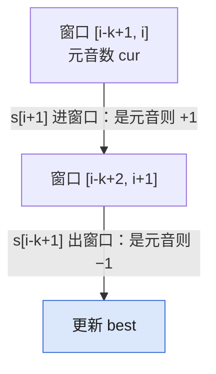

## Q
**LC 1456 定长子串中元音的最大数目**｜Medium

字符串 `s` 和整数 `k`，返回 `s` 中长度为 `k` 的子串里元音字母（`a e i o u`）个数的最大值。

## A
**一句话。** 定长滑动窗口：右端进一个字符，左端出一个字符，窗口内的元音数随之加减。

**图解。** 窗口右移一格：新进来的字符若是元音就加 1，被挤出去的若是元音就减 1，每一步取最大值。



```python
def max_vowels(s, k):
    vowels = set("aeiou")
    cur = best = 0
    for i, ch in enumerate(s):
        cur += ch in vowels          # 进窗口
        if i >= k:
            cur -= s[i - k] in vowels   # 出窗口
        best = max(best, cur)
    return best
```

**复杂度。** 时间 `O(n)`，空间 `O(1)`。

**易错点。**
- 窗口没满就更新：这里元音数只增不减，不会多算，但出窗口必须等 `i >= k`。
- 出窗口的下标写成 `s[i - k + 1]`：刚进来的第 `i` 个字符使窗口长度变成 `k + 1`，要移出的是 `s[i - k]`。

**追问。**
- 提前退出？：`best` 达到 `k` 就不可能更大，直接返回。
- 要最大值出现的位置？：更新 `best` 时同时记 `i - k + 1`。

**同模式。** LC 643 子数组最大平均数 I、LC 1004 最大连续1的个数 III、LC 1446 连续字符
