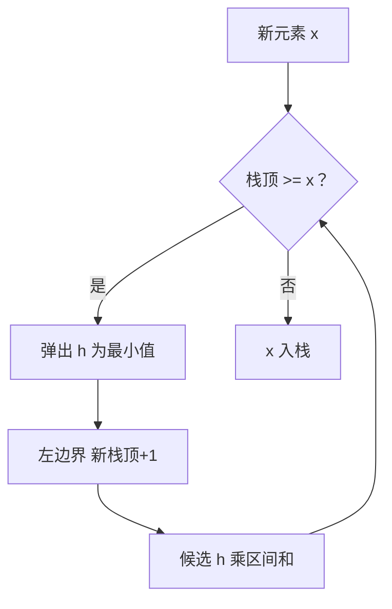

## Q
**LC 1856 子数组最小乘积的最大值**｜Medium

数组的"最小乘积"是子数组的最小值乘以子数组之和。给正整数数组 `nums`，求所有非空子数组的最大最小乘积，结果对 `10^9 + 7` 取模（先比较大小再取模）。

## A
**一句话。** 把每个元素当作子数组的最小值，用单调栈求它向左右最远能扩到哪，区间和用前缀和 `O(1)` 求。



```python
def max_sum_min_product(nums):
    n = len(nums)
    pre = [0] * (n + 1)
    for i, x in enumerate(nums):
        pre[i + 1] = pre[i] + x
    ans = 0
    st = []                                # 单调递增栈，存下标
    for i, x in enumerate(nums + [0]):     # 哨兵 0 清空栈
        while st and nums[st[-1]] >= x:
            h = nums[st.pop()]             # 以 h 为最小值
            left = st[-1] + 1 if st else 0
            ans = max(ans, h * (pre[i] - pre[left]))
        st.append(i)
    return ans % (10 ** 9 + 7)
```

**复杂度。** 时间 `O(n)`，空间 `O(n)`。

**易错点。**
- 取模后再比较大小：取模会打乱大小，必须用精确值比较，最后再取模。
- 没有哨兵：栈里剩下的元素没弹出，右边界是数组末尾的情形被漏掉。

**追问。**
- 相等的元素为什么可以直接弹出？：弹出时右边界偏短，但后面那个相等的元素会得到更长的区间，不会漏答案。

**同模式。** LC 2104 子数组范围和、LC 84 柱状图中最大的矩形、LC 739 每日温度、LC 907 子数组的最小值之和
