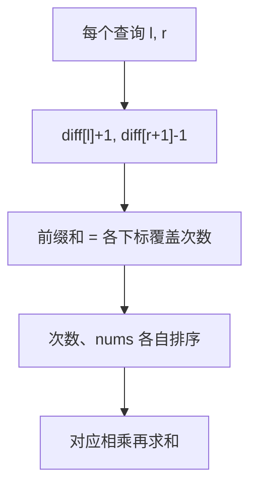

## Q
**LC 1589 所有排列中的最大和**｜Medium

数组 `nums` 和若干查询 `[l, r]`，每个查询求 `nums[l..r]` 的和。可以任意重排 `nums`，求所有查询之和的最大值，对 `10^9+7` 取模。

## A
**一句话。** 先用差分数组数出每个下标被查询覆盖了几次，再排序配对：覆盖次数多的下标放大数（排序不等式）。

**图解。** 差分里区间起点 `+1`、终点后一位 `-1`，前缀和就是每个位置的覆盖次数；次数和数值各自排序后一一相乘。



```python
def max_sum_range_query(nums, requests):
    n = len(nums)
    diff = [0] * (n + 1)
    for l, r in requests:
        diff[l] += 1               # 差分：区间 [l, r] 整体 +1
        diff[r + 1] -= 1
    cnt = []
    cur = 0
    for i in range(n):
        cur += diff[i]
        cnt.append(cur)            # 下标 i 被覆盖的次数
    nums.sort()
    cnt.sort()
    ans = sum(a * b for a, b in zip(nums, cnt))
    return ans % (10 ** 9 + 7)
```

**复杂度。** 时间 `O(n log n + q)`，空间 `O(n)`。

**易错点。**
- 每个查询逐个下标加 1：最坏 `O(nq)`，要用差分。
- 边算边取模再排序：排序必须用真实次数，取模只在最后做（Python 不会溢出）。

**追问。**
- 为什么排序配对最优？：排序不等式，两组数同序相乘之和最大，交换任意一对逆序都不会更好。
- 在线加查询怎么办？：用树状数组维护区间加、单点查，得到覆盖次数后同样排序。

**同模式。** LC 1094 拼车、LC 1109 航班预订统计、LC 2285 道路的最大总重要性、LC 1402 做菜顺序
