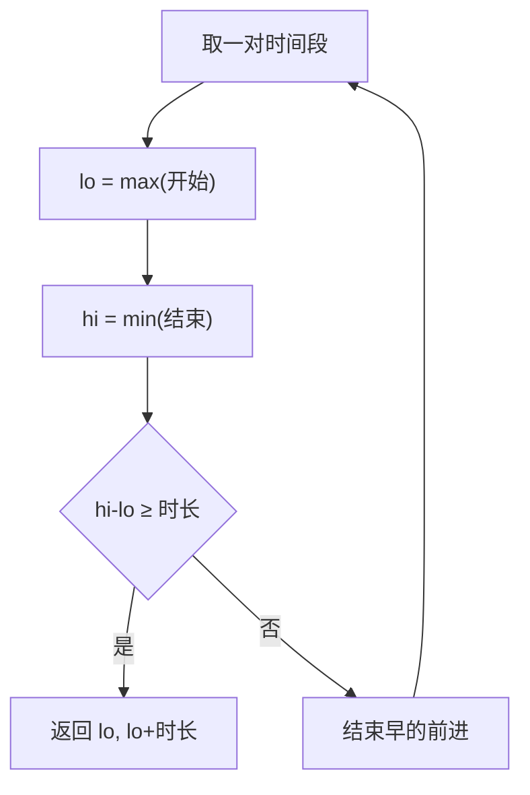

## Q
**LC 1229 安排会议日程**｜Medium

两个人各自的空闲时间段 `slots1`、`slots2`（`[start, end]`，同一人的时间段互不重叠），以及会议时长 `duration`。返回两人都空闲且长度恰为 `duration` 的最早时间段，没有返回 `[]`。

## A
**一句话。** 两组时间段各按开始时间排序，双指针求交集；交集够长就返回，否则丢弃结束更早的那个。

**图解。** 每次比较一对时间段：交集 `[max(开始), min(结束)]` 够长就返回；不够长就丢掉结束更早的（它不可能再和后面的段相交）。



```python
def min_available_duration(slots1, slots2, duration):
    slots1.sort()
    slots2.sort()
    i = j = 0
    while i < len(slots1) and j < len(slots2):
        lo = max(slots1[i][0], slots2[j][0])
        hi = min(slots1[i][1], slots2[j][1])
        if hi - lo >= duration:           # 交集够长
            return [lo, lo + duration]
        if slots1[i][1] < slots2[j][1]:   # 丢掉先结束的
            i += 1
        else:
            j += 1
    return []
```

**复杂度。** 时间 `O(n log n + m log m)`，空间 `O(1)`（不计排序）。

**易错点。**
- 丢掉开始更早的：应丢掉结束更早的，它不可能再和另一个人的后续时间段相交。
- 交集长度用 `hi - lo > duration`：恰好等于也够，用 `>=`。
- 返回整个交集：要返回长度恰为 `duration` 的片段，从 `lo` 开始截取。

**追问。**
- 和区间交集（LC 986）的区别？：那题要返回所有交集，这题只要最早的一个够长的。
- 为什么返回的就是最早的？：时间段按开始时间扫描，第一个够长的交集起点最小。

**同模式。** LC 986 区间列表的交集、LC 56 合并区间、LC 253 会议室 II
