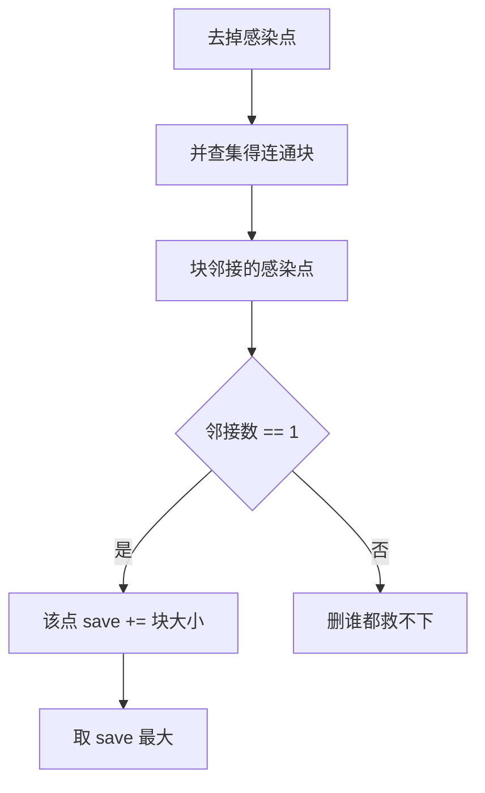

## Q
**LC 928 尽量减少恶意软件的传播 II**｜Hard

`graph[i][j] == 1` 表示结点 `i`、`j` 直接相连。`initial` 是初始感染的结点，感染会沿边传播到整个连通块。可以从 `initial` 中选一个结点，把它**连同其边一起从图中删除**，使最终感染的结点最少，返回该结点（并列取下标最小）。

## A
**一句话。** 先把所有初始感染点从图里拿掉，干净结点分成连通块；只被一个感染点碰到的块，删掉那个点就能整块保住。

**图解。** 删掉感染点后，每个干净连通块看有几个感染点与它相邻：只有 1 个的块，删去那个感染点就能救下整块，大小累加到该点上。



```python
def min_malware_spread(graph, initial):
    n, bad = len(graph), set(initial)
    parent = list(range(n))
    def find(x):
        while parent[x] != x:
            parent[x] = parent[parent[x]]
            x = parent[x]
        return x
    for i in range(n):               # 只合并干净结点
        for j in range(i):
            if graph[i][j] and not {i, j} & bad:
                parent[find(i)] = find(j)
    size = Counter(find(i) for i in range(n)
                   if i not in bad)
    touch = defaultdict(set)         # 块 -> 邻接的感染点
    for u in initial:
        for v in range(n):
            if graph[u][v] and v not in bad:
                touch[find(v)].add(u)
    save = Counter()
    for r, us in touch.items():
        if len(us) == 1:             # 只被一个感染点碰到
            save[next(iter(us))] += size[r]
    return min(initial, key=lambda u: (-save[u], u))
```

**复杂度。** 时间 `O(n²·α)`，空间 `O(n)`。

**易错点。**
- 沿用 LC 924 的做法：那题删点后原结点仍在图里，这题删除结点本身，所以要先去掉所有感染点再看连通块。
- 块被两个感染点碰到也算救下：删掉其中一个，另一个仍会感染整块。
- 无人可救时返回 `initial[0]`：应返回下标最小的，需要 `min`。

**追问。**
- 为什么先去掉全部初始点？：感染从初始点出发，干净块能被感染的唯一途径是邻接的感染点。
- 块大小怎么得到？：并查集合并后对根计数。

**同模式。** LC 924 尽量减少恶意软件的传播、LC 721 账户合并、LC 547 省份数量
