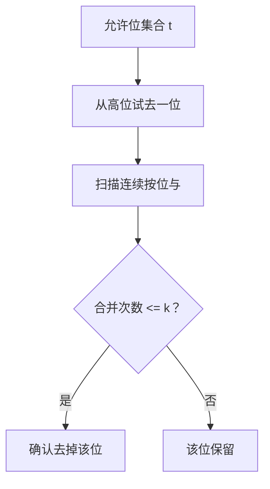

## Q
**LC 3022 给定操作次数内使剩余元素的或值最小**｜Hard

整数数组 `nums` 和 `k`。一次操作选相邻两个数，用它们的按位与替换这两个数（数组长度减一）。最多 `k` 次操作后，求剩余所有元素按位或的最小值。

## A
**一句话。** 从高位到低位贪心：尝试让答案的这一位为 `0`，用"贪心合并"计算所需最少操作数；不超过 `k` 就把这一位定为 `0`，否则保留为 `1`。



```python
def min_or_after_operations(nums, k):
    t = (1 << 30) - 1                  # 答案允许出现的位
    for b in range(29, -1, -1):
        t2 = t ^ (1 << b)              # 试着去掉第 b 位
        cur, cnt = -1, 0               # cur 全 1 表示空段
        for x in nums:
            cur &= x
            if cur & ~t2:              # 段与仍含禁用位，必须继续并入
                cnt += 1
            else:
                cur = -1               # 段干净，另起一段
        if cnt <= k:
            t = t2
    return t
```

**复杂度。** 时间 `O(30n)`，空间 `O(1)`。

**易错点。**
- 从低位开始贪心：高位影响更大，必须从高位决定。
- 不累积已经确定的结论：`t` 要延续上一轮已去掉的位，才是对"所有高位"的约束。
- 最后一段没闭合：它要并入前一段，操作数就是它的元素个数，循环里逐个累加已经算对。

**追问。**
- 为什么贪心计数正确？：为让某段的与不含禁用位，最短的做法是从段首累与直到干净，段内每多一个元素就多一次操作。

**同模式。** LC 421 数组中两个数的最大异或值、LC 2935 找出强数对的最大异或值 II
