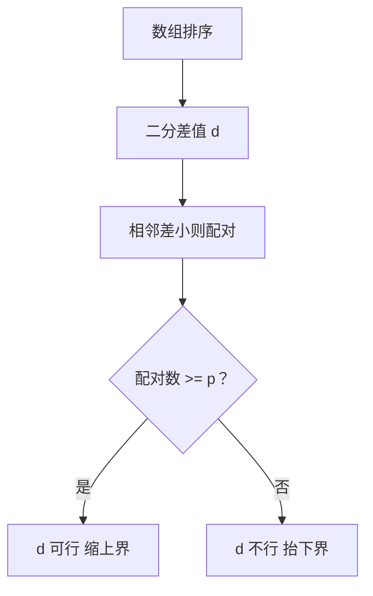

## Q
**LC 2616 最小化数对的最大差值**｜Medium

整数数组 `nums` 和整数 `p`。选出 `p` 个**不相交**的下标对，使这些对中差的绝对值的最大值最小。求这个最小值。

## A
**一句话。** 二分答案 `d`：排序后贪心地配相邻的元素（差 `<= d` 就配成一对并跳过两个），能配出 `p` 对说明 `d` 可行。



```python
def minimize_max(nums, p):
    nums.sort()
    n = len(nums)

    def ok(d):                       # 最大差不超过 d，能否配出 p 对
        cnt = i = 0
        while i < n - 1:
            if nums[i + 1] - nums[i] <= d:
                cnt += 1
                i += 2               # 配成一对，两个都用掉
            else:
                i += 1
        return cnt >= p

    lo, hi = 0, nums[-1] - nums[0]
    while lo < hi:
        mid = (lo + hi) // 2
        if ok(mid):
            hi = mid
        else:
            lo = mid + 1
    return lo
```

**复杂度。** 时间 `O(n log n + n log M)`，空间 `O(1)`。

**易错点。**
- 配对不相邻：排序后最优配对一定是相邻元素，隔一个配只会差更大。
- 配对后只跳一个：一个元素只能在一对里，要 `i += 2`。
- `p = 0`：`ok(0)` 为真，二分得到 `0`，与题意一致。

**追问。**
- 为什么贪心取相邻对最多？：从小到大，能配就配不会使后面的选择更差（交换论证）。

**同模式。** LC 198 打家劫舍、LC 875 爱吃香蕉的珂珂、LC 410 分割数组的最大值
