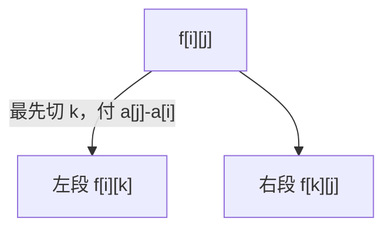

## Q
**LC 1547 切棍子的最小成本**｜Hard

长度为 `n` 的棍子，`cuts` 是要切的位置。一次切割的成本是被切棍子的当前长度。可以任意调整切割顺序，求切完所有位置的最小总成本。

## A
**一句话。** 区间 DP：把两端 `0`、`n` 加进排序后的切点数组，`f[i][j]` 是切开 `a[i]..a[j]` 内所有切点的最小成本，枚举最先切的点 `k`，成本为区间长度加两侧子问题。

**图解。** 先切 `k`：当前棍子 `a[i]..a[j]` 付成本 `a[j] - a[i]`，之后左右两段互不影响，各自独立求最优。



```python
def min_cost(n, cuts):
    a = [0] + sorted(cuts) + [n]
    m = len(a)
    # f[i][j]：切开 a[i]..a[j] 之间所有切点的最小成本
    f = [[0] * m for _ in range(m)]
    for i in range(m - 3, -1, -1):
        for j in range(i + 2, m):
            best = min(f[i][k] + f[k][j]
                       for k in range(i + 1, j))
            f[i][j] = best + a[j] - a[i]
    return f[0][m - 1]
```

**复杂度。** 时间 `O(c³)`，空间 `O(c²)`（`c` 为切点数）。

**易错点。**
- 忘了加两端 `0` 和 `n`：区间长度 `a[j] - a[i]` 需要端点，且要排序。
- 枚举「最后切的点」：这样子区间不独立；枚举最先切的点，左右两段才互不影响。
- 填表顺序错：`f[i][j]` 依赖 `f[i][k]`、`f[k][j]`（`k` 在中间），`i` 从大到小、`j` 从小到大才满足。

**追问。**
- 和戳气球（LC 312）有什么相似？：都是「区间里选一个最先或最后操作的点，把区间拆成独立两半」。
- 相邻切点间无需切割时？：`j = i + 1` 时区间里没有切点，`f` 为 `0`。

**同模式。** LC 312 戳气球、LC 1000 合并石头的最低成本、LC 1039 多边形三角剖分的最低得分
