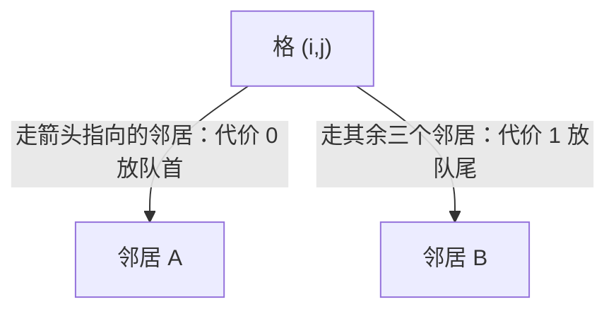

## Q
**LC 1368 使网格图至少有一条有效路径的最小代价**｜Hard

`grid[i][j]` 是 `1..4`，分别表示该格箭头指向右、左、下、上。从左上角出发沿箭头走，求让网格里至少存在一条通到右下角的路径所需的最少修改次数（每格至多改一次，改箭头代价 1）。

## A
**一句话。** 把每格向四个方向各看成一条边：顺着箭头的边权 0，其余边权 1，在这张图上跑 0-1 BFS 求最短路。

**图解。** 同一格往四个邻居走：和箭头一致代价 0（放队首），不一致代价 1（放队尾），队列中的距离始终只相差 1。



```python
def min_cost(grid):
    m, n = len(grid), len(grid[0])
    dirs = ((0, 1), (0, -1), (1, 0), (-1, 0))   # 对应箭头 1~4
    dist = [[inf] * n for _ in range(m)]
    dist[0][0] = 0
    dq = deque([(0, 0)])
    while dq:
        i, j = dq.popleft()
        for k, (dx, dy) in enumerate(dirs):
            x, y = i + dx, j + dy
            if not (0 <= x < m and 0 <= y < n):
                continue
            cost = 0 if grid[i][j] == k + 1 else 1  # 顺箭头免费
            if dist[i][j] + cost < dist[x][y]:
                dist[x][y] = dist[i][j] + cost
                if cost:
                    dq.append((x, y))
                else:
                    dq.appendleft((x, y))
    return dist[m - 1][n - 1]
```

**复杂度。** 时间 `O(mn)`，空间 `O(mn)`。

**易错点。**
- 用普通 BFS：边权有 0 和 1，普通 BFS 求不出最短，要双端队列（或 Dijkstra）。
- 免费边放队尾：会破坏队列里距离非降的性质，免费放队首、付费放队尾。
- 箭头编号错位：`dirs` 的顺序必须与箭头 `1,2,3,4` 对应（右、左、下、上）。

**追问。**
- 为什么 0-1 BFS 正确？：队列始终保持「队首 `d`、队尾 `d+1`」，等价于 Dijkstra 但免去了堆。
- 用 Dijkstra 行吗？：可以，`O(mn log(mn))`，思路相同。

**同模式。** LC 1263 推箱子、LC 2290 到达角落需要移除障碍物的最小数目、LC 1631 最小体力消耗路径
