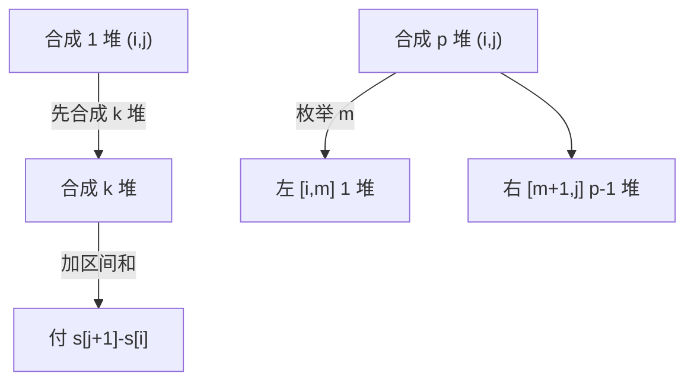

## Q
**LC 1000 合并石头的最低成本**｜Hard

有 `n` 堆石头排成一排，每次只能把**连续的 `k` 堆**合并成一堆，代价是这 `k` 堆的石头总数。求把所有石头合并成一堆的最小总代价，做不到返回 `-1`。

## A
**一句话。** 区间 DP：`dfs(i, j, p)` 表示把 `[i, j]` 合并成 `p` 堆的最小代价，`p = 1` 时先合成 `k` 堆再加区间和。

**图解。** 合成 `p` 堆时，分出最左一堆（长度 `≡ 1 (mod k-1)` 的前缀），剩下的合成 `p-1` 堆；合成 1 堆则是「先合成 `k` 堆，再合并，付区间和」。



```python
def merge_stones(stones, k):
    n = len(stones)
    if (n - 1) % (k - 1):         # 每次少 k-1 堆，不整除就不可能
        return -1
    s = list(accumulate(stones, initial=0))
    @cache
    def dfs(i, j, p):             # [i, j] 合成 p 堆的最小代价
        if p == 1:
            if i == j:
                return 0
            return dfs(i, j, k) + s[j + 1] - s[i]
        return min(dfs(i, m, 1) + dfs(m + 1, j, p - 1)
                   for m in range(i, j, k - 1))
    return dfs(0, n - 1, 1)
```

**复杂度。** 时间 `O(n³)`，空间 `O(n²k)`。

**易错点。**
- 漏判可行性：每次合并总堆数减 `k-1`，`(n-1) % (k-1) != 0` 时无解，直接返回 `-1`。
- 枚举分割点步长写成 `1`：左边合成 1 堆的长度必须是 `1 mod (k-1)`，步长是 `k-1`，否则递归会进入无解区间。
- `p == 1` 时区间和重复加：只有把 `k` 堆再合成 `1` 堆这一步付区间和，合成多堆时不付。

**追问。**
- 为什么合成 `1` 堆要经过 `k` 堆？：最后一次合并正好用到 `k` 堆，这一步才付一次区间和。
- 能不能做到 `O(n³/k)`？：分割点步长是 `k-1`，枚举量约为 `n/(k-1)`。

**同模式。** LC 312 戳气球、LC 1547 切棍子的最小成本、LC 1130 叶值的最小代价生成树
