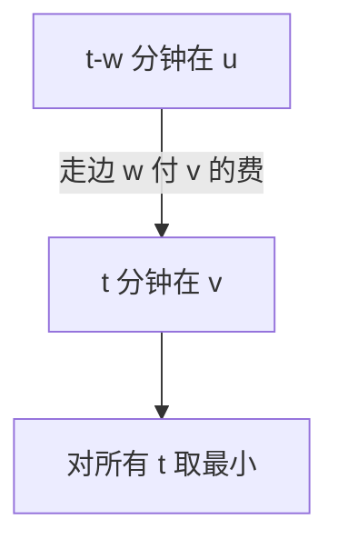

## Q
**LC 1928 规定时间内到达终点的最小花费**｜Hard

`n` 个城市，`edges[i] = [x, y, time]` 是双向路。`passingFees[i]` 是经过城市 `i` 时支付的费用（每次经过都要付，包括起点和终点）。要求在 `maxTime` 分钟内从城市 `0` 到城市 `n-1`，求最小总费用，做不到返回 `-1`。

## A
**一句话。** 时间有限、边权为整数，按"时刻"建 DP：`dp[t][v]` 表示恰好第 `t` 分钟到达 `v` 的最小费用，由 `dp[t - w][u] + fee[v]` 转移。



```python
def min_cost(max_time, edges, passing_fees):
    n = len(passing_fees)
    dp = [[inf] * n for _ in range(max_time + 1)]
    dp[0][0] = passing_fees[0]
    for t in range(1, max_time + 1):
        for x, y, w in edges:
            if w <= t:                       # 两个方向都试
                fy, fx = passing_fees[y], passing_fees[x]
                dp[t][y] = min(dp[t][y], dp[t - w][x] + fy)
                dp[t][x] = min(dp[t][x], dp[t - w][y] + fx)
    ans = min(dp[t][n - 1] for t in range(max_time + 1))
    return -1 if ans == inf else ans
```

**复杂度。** 时间 `O(maxTime · E)`，空间 `O(maxTime · n)`。

**易错点。**
- 只按城市做 Dijkstra：省钱和省时间是两个维度，只记最小费用会丢掉"慢但便宜"之外的"快但贵"路径。
- 边只转移一个方向：路是双向的，`x → y` 和 `y → x` 都要更新。
- 答案只看 `dp[max_time][n-1]`：不一定要用满时间，要对所有 `t` 取最小。

**追问。**
- 为什么能按 `t` 递推？：边耗时 `>= 1`，`dp[t]` 只依赖更小的 `t`，没有环。

**同模式。** LC 787 K 站中转内最便宜的航班、LC 743 网络延迟时间、LC 1631 最小体力消耗路径
