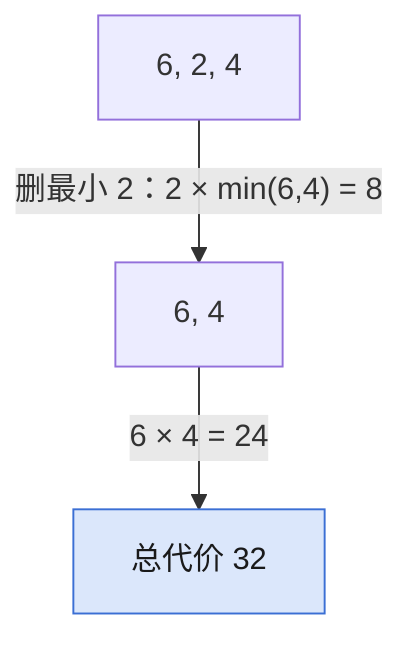

## Q
**LC 1130 叶值的最小代价生成树**｜Medium

`arr` 是一棵二叉树中序遍历的所有叶子值（每个非叶结点恰有两个孩子）。非叶结点的值是左、右子树中最大叶子值的乘积。求所有非叶结点值之和的最小值。

## A
**一句话。** 单调栈贪心：每次合并「最小的叶子」，它只能和左右两个邻居里较小的那个合并，代价 `最小值 × 较小邻居`。

**图解。** `[6,2,4]`：最小的 `2` 与较小邻居 `4` 合并，代价 `8`，剩 `[6,4]`；再合并 `6 × 4 = 24`，总计 `32`。



```python
def mct_from_leaf_values(arr):
    ans, st = 0, [inf]                # 单调递减栈，哨兵 inf
    for x in arr:
        while st[-1] <= x:
            mid = st.pop()            # 局部最小：先合并
            ans += mid * min(st[-1], x)   # 乘较小的邻居
        st.append(x)
    while len(st) > 2:                # 剩下递减序列：从小到大合并
        ans += st.pop() * st[-1]
    return ans
```

**复杂度。** 时间 `O(n)`，空间 `O(n)`。

**易错点。**
- 忘了哨兵 `inf`：栈空时 `st[-1]` 越界，也无法保证 `min(st[-1], x)` 有意义。
- `while st[-1] <= x` 写成 `<`：相等的值也应弹出，否则之后会重复处理。
- 结尾不处理剩下的栈：递减栈里相邻两个仍要合并，别漏了最后的循环。

**追问。**
- 为什么最小的叶子先合并最优？：它的父结点至少乘一个比它大的邻居，合并后它不再出现，让更大的数少参与乘积。
- 区间 DP 怎么写？：`f[i][j] = min(f[i][k] + f[k+1][j] + max(i..k) × max(k+1..j))`，`O(n³)`。

**同模式。** LC 84 柱状图中最大的矩形、LC 1000 合并石头的最低成本、LC 96 不同的二叉搜索树
