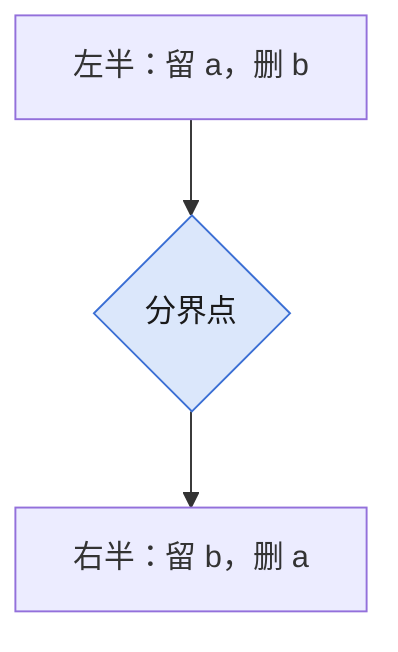

## Q
**LC 1653 使字符串平衡的最少删除次数**｜Medium

字符串 `s` 只含 `a` 和 `b`。若不存在下标 `i < j` 使 `s[i] = 'b'` 且 `s[j] = 'a'`，则它是平衡的。求最少删除多少个字符才能平衡。

## A
**一句话。** 平衡串形如 `aaa…bbb`，等价于选一个分界点，删掉左边的所有 `b` 和右边的所有 `a`；一遍扫描维护「到当前为止的最少删除数」。

**图解。** 每个分界点的代价 = 左边 `b` 的个数 + 右边 `a` 的个数，取最小。



```python
def minimum_deletions(s):
    res = b = 0                  # b：目前出现的 b 的个数
    for ch in s:
        if ch == "b":
            b += 1               # b 暂时不用处理
        else:
            # 当前 a 要么删掉，要么保留并删掉前面全部 b
            res = min(res + 1, b)
    return res
```

**复杂度。** 时间 `O(n)`，空间 `O(1)`。

**易错点。**
- 只统计「`b` 后面的 `a`」的个数：这只是其中一种做法的代价，必须在「删这个 `a`」和「删前面所有 `b`」之间取最小。
- 遇到 `b` 就更新 `res`：`b` 排在前面并不违规，不需要删。

**追问。**
- 前后缀怎么做？：先算每个位置右边 `a` 的个数，再扫一遍，用左边 `b` 的个数加上它，取最小。
- 和 LC 926 的区别？：这里是删字符，LC 926 是翻转字符，转移完全一样，只是「删 `a`」换成「翻转 `a`」。

**同模式。** LC 926 将字符串翻转到单调递增、LC 2938 区分黑球与白球、LC 1004 最大连续1的个数 III
