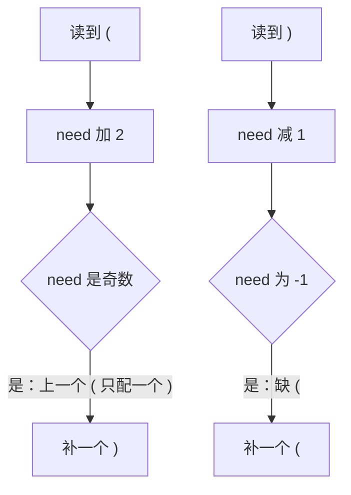

## Q
**LC 1541 平衡括号字符串的最少插入次数**｜Medium

只含 `(` 和 `)` 的字符串，平衡的定义：每个 `(` 后面恰好跟着**两个连续的** `)`，且左右括号配对正确。求使字符串平衡的最少插入次数（可插入 `(` 或 `)`）。

## A
**一句话。** 维护「还需要多少个 `)`」：每个 `(` 增加 2；遇到 `)` 减 1，减到负数说明缺 `(`，补一个并留下 1 个需求；`(` 来时若需求是奇数，说明上一个 `(` 只配了一个 `)`，补一个 `)`。

**图解。** 需求 `need` 的奇偶就是「当前 `(` 是否只配了半对」：遇到 `(` 时若 `need` 已是奇数，先补一个 `)` 才能再开新的。



```python
def min_insertions(s):
    ans = need = 0                     # need：还需要多少个 )
    for c in s:
        if c == "(":
            need += 2
            if need % 2:               # 上一个 ( 只配了一个 )
                ans += 1               # 补一个 )
                need -= 1
        else:
            need -= 1
            if need < 0:               # 多出一个 )：前面补一个 (
                ans += 1
                need = 1               # 新补的 ( 还差一个 )
    return ans + need                  # 结尾还缺的 ) 全补上
```

**复杂度。** 时间 `O(n)`，空间 `O(1)`。

**易错点。**
- 用栈存 `(` 并要求 `)` 单个配对：这里一个 `(` 要吃两个 `)`，用计数「还需要多少 `)`」更直接。
- 遇到 `(` 时没检查奇数：上一个 `(` 若只拿到一个 `)`，必须先补一个 `)`，才能开始新的 `(`。
- `need` 变负后只加 `ans`：补的 `(` 还需要两个 `)`，当前这个 `)` 吃掉一个，所以 `need = 1`。

**追问。**
- 为什么奇偶就能判断？：每个 `(` 要两个 `)`，`need` 为奇数说明刚好有一个 `(` 只被配了一半。
- 允许一个 `(` 配一个 `)`（LC 921）？：`need` 每次只加 1，更简单。

**同模式。** LC 921 使括号有效的最少添加、LC 1249 移除无效的括号、LC 32 最长有效括号
