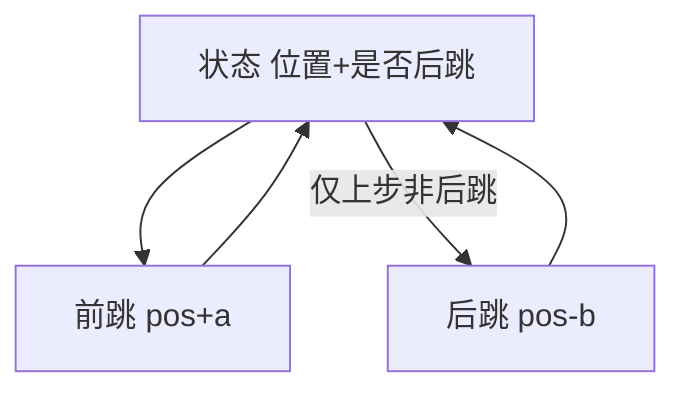

## Q
**LC 1654 到家的最少跳跃次数**｜Medium

虫子从 `0` 出发想到 `x`。每次可向前跳 `a`，或向后跳 `b`，但不能连续向后跳两次，不能跳到负数位置，也不能落在 `forbidden` 的位置。求最少跳跃次数，到不了返回 `-1`。

## A
**一句话。** 状态是（位置，上一步是否向后），用 BFS 找最短步数；位置设上界 `max(x, 最大禁点) + a + b` 即可保证有限。



```python
def minimum_jumps(forbidden, a, b, x):
    ban = set(forbidden)
    limit = max([x] + forbidden) + a + b
    q = deque([(0, 0)])
    seen = {(0, 0)}
    step = 0
    while q:
        for _ in range(len(q)):
            pos, back = q.popleft()
            if pos == x:
                return step
            nxt = [(pos + a, 0)]
            if not back:
                nxt.append((pos - b, 1))
            for p, f in nxt:
                if (0 <= p <= limit and p not in ban
                        and (p, f) not in seen):
                    seen.add((p, f))
                    q.append((p, f))
        step += 1
    return -1
```

**复杂度。** 时间 `O(limit)`，空间 `O(limit)`。

**易错点。**
- 状态里漏掉"上一步是否后跳"：同一位置的两种状态后续可走的步不同，不能合并。
- 不设上界：向前跳可以无限走，BFS 不会结束。

**追问。**
- 上界为什么是这个值？：越过 `max(x, 最大禁点)` 之后再往前走 `a` 就回不来，超过再加 `a + b` 的位置没有新的可达状态。

**同模式。** LC 1306 跳跃游戏 III、LC 1345 跳跃游戏 IV、LC 127 单词接龙、LC 45 跳跃游戏 II
