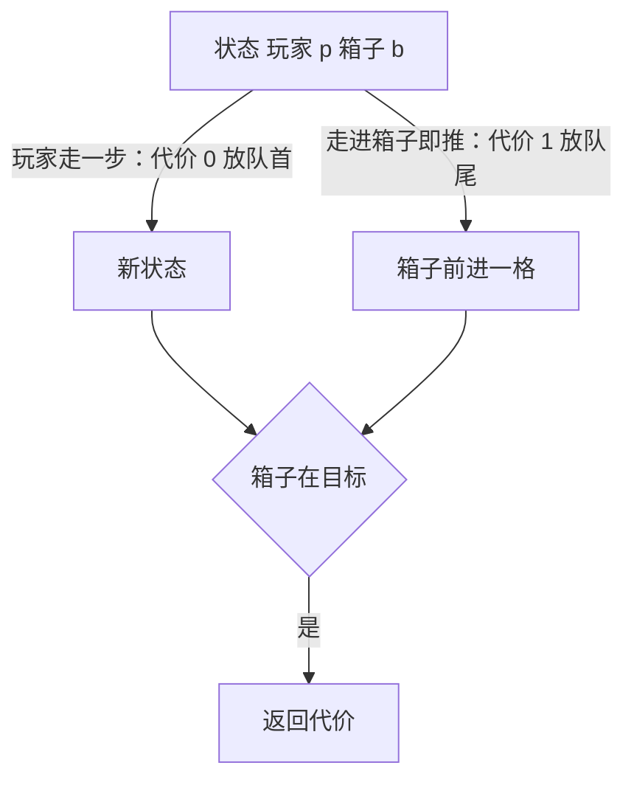

## Q
**LC 1263 推箱子**｜Hard

网格里 `S` 是玩家，`B` 是箱子，`T` 是目标，`#` 是墙，`.` 是空地。玩家只能走空地，走进箱子所在格就把箱子推一格（箱子前方必须是空地）。求把箱子推到目标的最少推动次数，做不到返回 `-1`。

## A
**一句话。** BFS 的状态是（玩家位置，箱子位置）：玩家自己走一步代价 0，推箱子代价 1，用双端队列做 0-1 BFS。

**图解。** 走路不改变推动次数，放在队首；推箱子要加一，放在队尾，这样队列中推动次数始终非降。



```python
def min_push_box(grid):
    m, n = len(grid), len(grid[0])
    pos = {grid[i][j]: (i, j)
           for i in range(m) for j in range(n)}
    player, box, target = pos["S"], pos["B"], pos["T"]
    def ok(x, y):
        return (0 <= x < m and 0 <= y < n
                and grid[x][y] != "#")
    dist = {(player, box): 0}
    dq = deque([(player, box)])
    while dq:
        p, b = dq.popleft()
        d = dist[(p, b)]
        if b == target:
            return d
        for dx, dy in ((1, 0), (-1, 0), (0, 1), (0, -1)):
            q = (p[0] + dx, p[1] + dy)
            if not ok(*q):
                continue
            nb, cost = b, 0                # 玩家自己走：代价 0
            if q == b:                     # 走进箱子：推
                nb, cost = (b[0] + dx, b[1] + dy), 1
                if not ok(*nb):
                    continue
            if d + cost < dist.get((q, nb), inf):
                dist[(q, nb)] = d + cost
                if cost:
                    dq.append((q, nb))
                else:
                    dq.appendleft((q, nb))
    return -1
```

**复杂度。** 时间 `O((mn)²)`，空间 `O((mn)²)`。

**易错点。**
- 只记箱子位置：玩家可能在箱子的另一侧，不能推，状态必须包含玩家位置。
- 把走路也算一步：只有推箱子才计数，用 0-1 BFS 或在每次推之前用 BFS 判断玩家能否绕到推的位置。
- 玩家把箱子当墙：走进箱子所在格就是推，要检查箱子前方是否可走。

**追问。**
- 为什么 0-1 BFS 的队首总是最小代价？：代价 0 的边放队首、代价 1 的放队尾，队列里的代价只在 `d` 和 `d + 1` 之间。
- 还有别的写法？：按「推」分层的 BFS，每层用内层 BFS 判断玩家能否到达推位。

**同模式。** LC 773 滑动谜题、LC 1368 使网格图至少有一条有效路径的最小代价、LC 864 获取所有钥匙的最短路径
