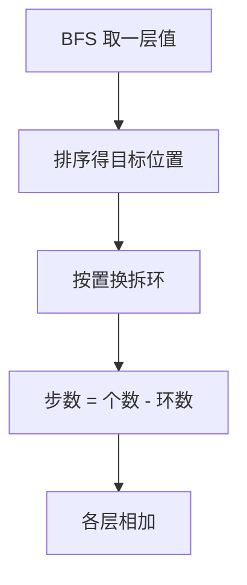

## Q
**LC 2471 逐层排序二叉树所需的最少操作数目**｜Medium

二叉树，节点值互不相同。每次操作可以选**同一层**的任意两个节点交换它们的值。求使每一层的值严格递增所需的最少操作数。

## A
**一句话。** 层与层独立；一层里按值排序得到每个位置的目标位置，形成置换，最少交换次数 = 元素个数 - 环的个数。



```python
def minimum_operations(root):
    ans = 0
    level = [root]
    while level:
        vals = [x.val for x in level]
        rank = {v: i for i, v in enumerate(sorted(vals))}
        p = [rank[v] for v in vals]       # 位置 i 的数应去 p[i]
        seen = [False] * len(vals)
        cycles = 0
        for i in range(len(vals)):
            if not seen[i]:
                cycles += 1
                j = i
                while not seen[j]:
                    seen[j] = True
                    j = p[j]
        ans += len(vals) - cycles
        level = [c for x in level
                 for c in (x.left, x.right) if c]
    return ans
```

**复杂度。** 时间 `O(n log n)`，空间 `O(n)`。

**易错点。**
- 把整棵树一起排序：只能同层交换，要逐层处理。
- 环的长度为 `1`：它贡献 `0` 步，上式 `个数 - 环数` 自然处理。

**追问。**
- 为什么一个环 `L` 个元素要 `L - 1` 次？：每次交换让一个元素归位，最后一次同时归位两个。

**同模式。** LC 2459 通过移动项目到空白区域来排序数组、LC 765 情侣牵手
