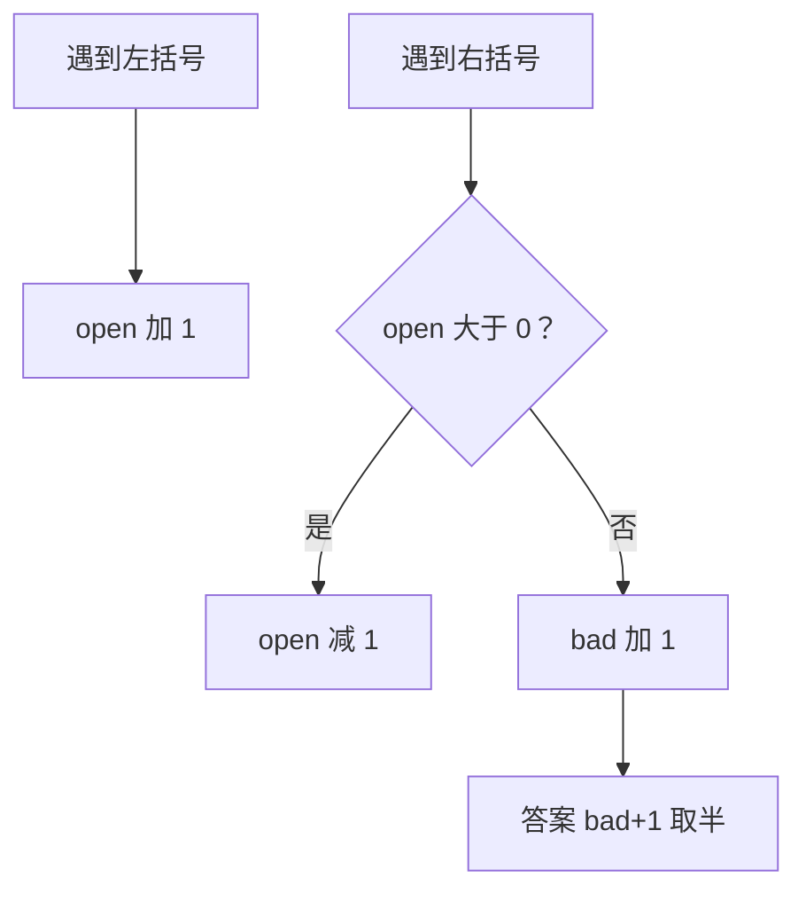

## Q
**LC 1963 使字符串平衡的最小交换次数**｜Medium

长度为偶数 `n` 的字符串 `s`，恰好有 `n / 2` 个 `[` 和 `n / 2` 个 `]`。可以交换任意两个位置的字符任意多次。求使 `s` 成为平衡括号串所需的最少交换次数。

## A
**一句话。** 扫描时多出来的 `]` 无法匹配，设有 `bad` 个；一次交换能同时修好两个，所以答案是 `(bad + 1) // 2`。



```python
def min_swaps(s):
    open_, bad = 0, 0
    for c in s:
        if c == '[':
            open_ += 1
        elif open_:
            open_ -= 1
        else:
            bad += 1               # 多余的 ]
    return (bad + 1) // 2
```

**复杂度。** 时间 `O(n)`，空间 `O(1)`。

**易错点。**
- 答案写成 `bad`：一次交换把一个多余的 `]` 和后面的一个多余的 `[` 同时换位，能修两个。
- 奇数个 `bad` 时用 `bad // 2`：向上取整，`bad = 1` 也要一次。

**追问。**
- 为什么每次交换最多修两个？：交换只涉及两个位置，每个位置至多消除一个失配。

**同模式。** LC 921 使括号有效的最少添加、LC 1190 反转每对括号间的子串、LC 1790 仅执行一次字符串交换能否使两个字符串相等、LC 854 相似度为 K 的字符串
