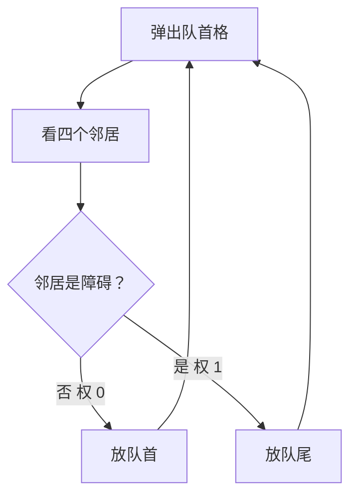

## Q
**LC 2290 到达角落需要移除障碍物的最小数目**｜Hard

`m x n` 的 0/1 网格：`0` 是空地，`1` 是障碍。可以向四个方向走，进入障碍格需要移除它。求从 `(0, 0)` 到 `(m-1, n-1)` 最少需要移除的障碍数。

## A
**一句话。** 把"进入障碍格"当作边权 `1`、进入空地当作边权 `0`，用 0-1 BFS：权 `0` 的邻居放队首，权 `1` 的放队尾。



```python
def minimum_obstacles(grid):
    m, n = len(grid), len(grid[0])
    dist = [[inf] * n for _ in range(m)]
    dist[0][0] = 0
    q = deque([(0, 0)])
    while q:
        i, j = q.popleft()
        for x, y in (i+1, j), (i-1, j), (i, j+1), (i, j-1):
            if 0 <= x < m and 0 <= y < n:
                d = dist[i][j] + grid[x][y]
                if d < dist[x][y]:
                    dist[x][y] = d
                    if grid[x][y]:
                        q.append((x, y))       # 权 1，队尾
                    else:
                        q.appendleft((x, y))   # 权 0，队首
    return dist[m - 1][n - 1]
```

**复杂度。** 时间 `O(mn)`，空间 `O(mn)`。

**易错点。**
- 用普通 BFS：边权不全是 `1`，先到未必最少，要用 0-1 BFS 或 Dijkstra。
- 起点是障碍：题目保证 `(0, 0)` 和终点是空地，所以 `dist[0][0] = 0`。

**追问。**
- 为什么 0-1 BFS 比 Dijkstra 好？：边权只有 `0/1` 时用双端队列代替堆，省掉 `log` 因子。

**同模式。** LC 743 网络延迟时间、LC 1368 使网格图至少有一条有效路径的最小代价、LC 1631 最小体力消耗路径
