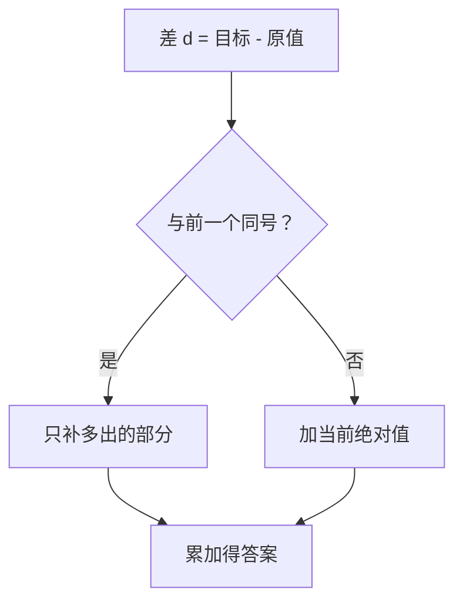

## Q
**LC 3229 使数组等于目标数组所需的最少操作次数**｜Hard

两个等长正整数数组 `nums`、`target`。一次操作可以选 `nums` 的任意子数组，把它们都加 `1` 或都减 `1`。求把 `nums` 变成 `target` 的最少操作数。

## A
**一句话。** 设 `d[i] = target[i] - nums[i]`：相邻同号时，需要新增的操作只有 `max(0, |d[i]| - |d[i-1]|)`，异号时是 `|d[i]|`；累加即可。



```python
def minimum_operations(nums, target):
    ans = prev = 0
    for a, b in zip(nums, target):
        d = b - a
        if d * prev > 0:                  # 同号，可复用上一段的操作
            ans += max(0, abs(d) - abs(prev))
        else:
            ans += abs(d)
        prev = d
    return ans
```

**复杂度。** 时间 `O(n)`，空间 `O(1)`。

**易错点。**
- 把异号也当同号处理：一加一减的操作不能共用，必须重新计。
- `d` 为 `0`：`d * prev` 为 `0`，走 `else`，加 `0`，没问题。

**追问。**
- 全是同号时等于什么？：`Σ max(0, d[i] - d[i-1])`，经典的"形成目标数组的子数组最少增加次数"（LC 1526）。

**同模式。** LC 1526 形成目标数组的子数组最少增加次数、LC 1094 拼车
