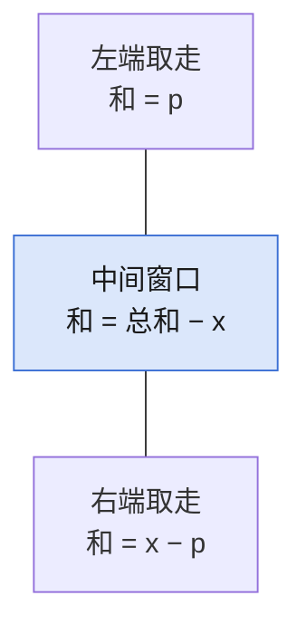

## Q
**LC 1658 将 x 减到 0 的最小操作数**｜Medium

正整数数组 `nums`，每次操作从数组最左或最右取走一个数并从 `x` 中减去它。求把 `x` 恰好减到 0 的最少操作数，做不到返回 `-1`。

## A
**一句话。** 取走的是两端的若干数，留下的是中间一段连续子数组；问题等价于求和为 `sum(nums) - x` 的最长子数组，答案是 `n` 减去它的长度。

**图解。** 两端取走的数之和为 `x`，留在中间的窗口之和就是 `总和 - x`，窗口越长，操作越少。



```python
def min_operations(nums, x):
    target = sum(nums) - x
    if target < 0:
        return -1
    left = cur = 0
    best = -1                    # 和为 target 的最长窗口
    for right, v in enumerate(nums):
        cur += v
        while cur > target:      # 数都为正，超了就缩左端
            cur -= nums[left]
            left += 1
        if cur == target:
            best = max(best, right - left + 1)
    return -1 if best < 0 else len(nums) - best
```

**复杂度。** 时间 `O(n)`，空间 `O(1)`。

**易错点。**
- 直接模拟「每次取哪一端」：分支指数增长，换成找中间窗口就是线性。
- `target < 0` 时不返回 `-1`：总和都不够 `x`。
- `target == 0`：窗口可以为空，答案是 `n`；上面的写法会在窗口缩空时记下长度 0，自然得到 `n`。

**追问。**
- 为什么能用滑动窗口？：数组全为正，窗口和随右端扩大单调增、左端收缩单调减。
- 含负数怎么办？：改用前缀和加哈希表，记每个前缀和第一次出现的位置。

**同模式。** LC 1423 可获得的最大点数、LC 209 长度最小的子数组、LC 560 和为 K 的子数组、LC 1004 最大连续1的个数 III
