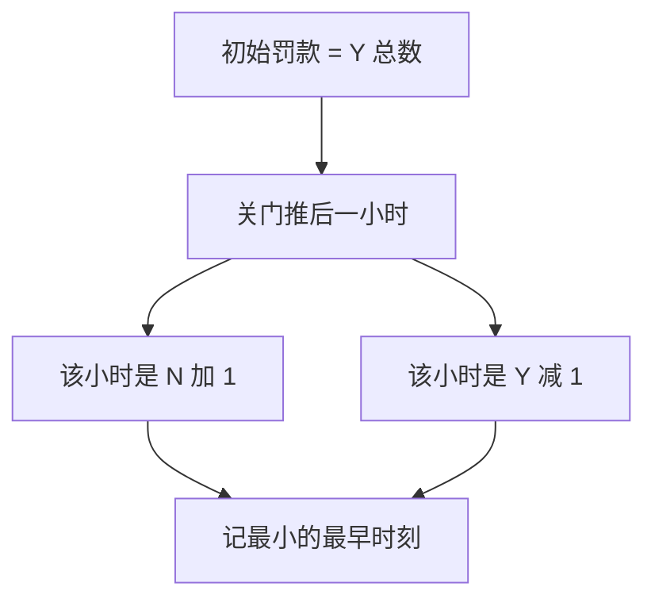

## Q
**LC 2483 商店的最少代价**｜Medium

字符串 `customers` 的第 `i` 位是 `Y` 表示第 `i` 小时有顾客，`N` 表示没有。若在第 `j` 小时关门，罚款 = 关门前没有顾客的小时数（`N`）+ 关门后（含第 `j` 小时）有顾客的小时数（`Y`）。返回罚款最小的最早关门时间（可取 `0` 到 `n`）。

## A
**一句话。** 关门时间从 `0` 变到 `1`、`2`…时，罚款每过一小时增减一次：遇到 `N` 加 `1`，遇到 `Y` 减 `1`；从"全部 Y 数"出发，记录最小值第一次出现的位置。



```python
def best_closing_time(customers):
    pen = customers.count('Y')          # 第 0 小时就关门的罚款
    best, ans = pen, 0
    for i, c in enumerate(customers):
        pen += 1 if c == 'N' else -1    # 开着多一小时
        if pen < best:                  # 严格小于，保证最早
            best, ans = pen, i + 1
    return ans
```

**复杂度。** 时间 `O(n)`，空间 `O(1)`。

**易错点。**
- 用 `<=` 更新：平局时会取更晚的关门时间，要求最早。
- 答案下标写成 `i`：关门时间是营业了 `i + 1` 个小时之后。

**追问。**
- 这是什么模型？：和 LC 1653 同类，前缀代价加后缀代价，扫描一遍增量更新。

**同模式。** LC 1653 使字符串平衡的最少删除次数、LC 926 将字符串翻转到单调递增、LC 1888 使二进制字符串字符交替的最少反转次数
