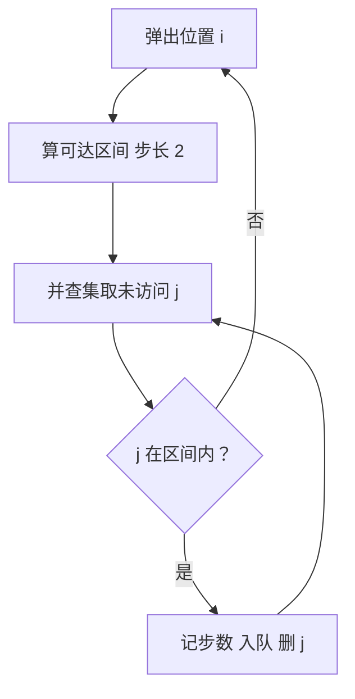

## Q
**LC 2612 最少翻转操作数**｜Hard

长度 `n` 的数组，只有位置 `p` 是 `1`，其余是 `0`，`banned` 中的位置永远不能是 `1`。每次可以选长度 `k` 的子数组翻转，但翻转后 `1` 不能落到 `banned` 位置。对每个下标 `i`，求让 `1` 到达 `i` 的最少翻转次数，到不了为 `-1`。

## A
**一句话。** 把 `1` 的位置当 BFS 节点：从 `i` 一次翻转能到的位置是区间 `[max(i-k+1, k-1-i), min(i+k-1, 2n-k-i-1)]` 内与它同奇偶步长 `2` 的点；用并查集（"下一个未访问同奇偶位置"）保证每个点只访问一次。



```python
def min_reverse_operations(n, p, banned, k):
    ans = [-1] * n
    ans[p] = 0
    nxt = list(range(n + 2))   # nxt[x]：>= x 的最小未访问同奇偶点

    def find(x):
        while nxt[x] != x:
            nxt[x] = nxt[nxt[x]]
            x = nxt[x]
        return x

    nxt[p] = p + 2                    # 起点与 banned 视为已访问
    for b in banned:
        nxt[b] = b + 2
    q = deque([p])
    while q:
        i = q.popleft()
        lo = max(i - k + 1, k - 1 - i)
        hi = min(i + k - 1, 2 * n - k - i - 1)
        j = find(lo)
        while j <= hi:
            ans[j] = ans[i] + 1
            q.append(j)
            nxt[j] = j + 2            # 删除 j
            j = find(j + 2)
    return ans
```

**复杂度。** 时间 `O(n α(n))`，空间 `O(n)`。

**易错点。**
- 对每个点枚举可达区间：总共 `O(nk)`，要用并查集跳过已访问的点。
- 步长写成 `1`：翻转后位置的奇偶由 `i` 和 `k` 决定，同一轮可达的点步长为 `2`。
- 并查集数组只开 `n`：`find` 可能走到 `n` 或 `n + 1`，要多留两个哨兵。

**追问。**
- 可达区间怎么来？：翻转 `[s, s + k - 1]`，`1` 从 `i` 到 `2s + k - 1 - i`；`s` 在 `[max(0, i-k+1), min(i, n-k)]` 内取值。

**同模式。** LC 1345 跳跃游戏 IV、LC 1871 跳跃游戏 VII、LC 45 跳跃游戏 II
