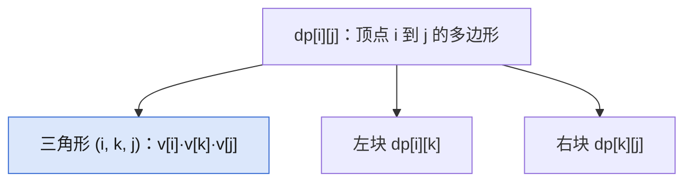

## Q
**LC 1039 多边形三角剖分的最低得分**｜Medium

凸多边形按顺时针给出各顶点的值 `values`。把它剖分成 `n - 2` 个三角形，每个三角形的得分是三个顶点值之积，总得分是所有三角形得分之和，求最小总得分。

## A
**一句话。** 区间 DP：`dp[i][j]` 是顶点 `i..j` 围成的多边形的最小得分；边 `(i, j)` 必属于某个三角形 `(i, k, j)`，它把多边形分成左右两块，各自独立求解。

**图解。** 固定底边 `(i, j)` 后枚举第三个顶点 `k`：三角形的积加上左右两块的最优解。



```python
def min_score_triangulation(values):
    n = len(values)
    dp = [[0] * n for _ in range(n)]
    for i in range(n - 3, -1, -1):      # 左端点从后往前
        for j in range(i + 2, n):       # 至少 3 个顶点才有三角形
            dp[i][j] = min(
                dp[i][k] + dp[k][j]
                + values[i] * values[k] * values[j]
                for k in range(i + 1, j))
    return dp[0][n - 1]
```

**复杂度。** 时间 `O(n^3)`，空间 `O(n^2)`。

**易错点。**
- 遍历顺序错：`dp[i][k]`、`dp[k][j]` 的区间都比 `[i, j]` 短，要先算短的，所以 `i` 倒序、`j` 正序。
- 少于 3 个顶点的区间得分是 0：`dp[i][i + 1]` 保持初值 0。
- 以为每个顶点只能被一个三角形用：一个顶点可以属于多个三角形。

**追问。**
- 和戳气球有什么关系？：同一类区间 DP，「最后选谁」把区间一分为二，两侧互不影响。
- 能更快吗？：这个形式没有已知的更优解，`O(n^3)` 就是标准答案。

**同模式。** LC 312 戳气球、LC 1000 合并石头的最低成本、LC 87 扰乱字符串、LC 516 最长回文子序列
