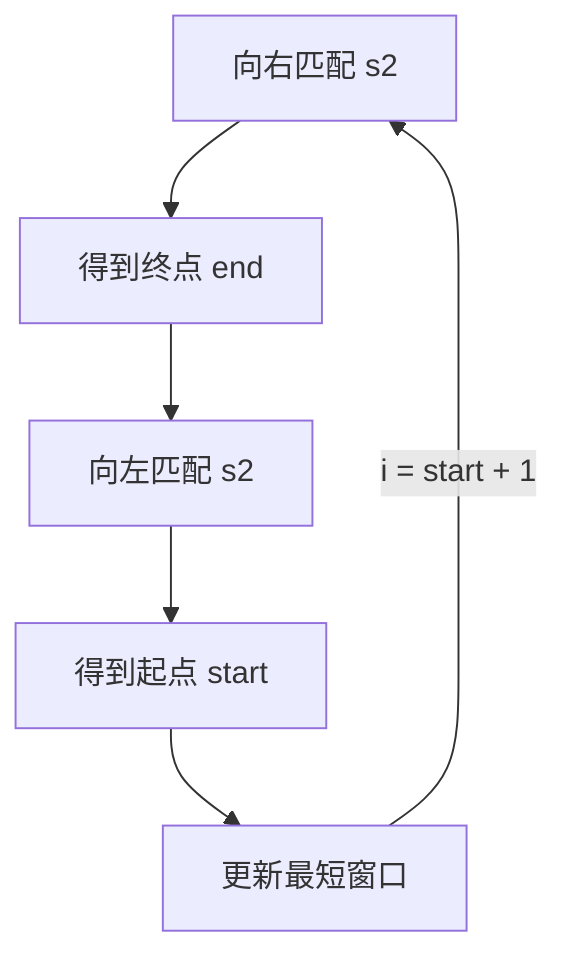

## Q
**LC 727 最小窗口子序列**｜Hard

给字符串 `s1`、`s2`，求 `s1` 中最短的连续子串，使 `s2` 是它的子序列；有多个返回起点最靠左的，没有返回 `""`。

## A
**一句话。** 先向右贪心匹配完 `s2` 得到终点，再从终点向左反向匹配收紧起点，得到以该终点结束的最短窗口。

**图解。** 正向找到终点 `e`（匹配完 `s2`），再从 `e` 反向匹配 `s2` 得起点 `s`，下一轮从 `s+1` 继续。



```python
def min_window(s1, s2):
    n, m = len(s1), len(s2)
    best, i = "", 0
    while i < n:
        j = 0
        while i < n:                  # 向右把 s2 匹配完
            if s1[i] == s2[j]:
                j += 1
                if j == m:
                    break
            i += 1
        if i == n:
            break
        end = i
        while j > 0:                  # 从 end 向左收紧起点
            if s1[i] == s2[j - 1]:
                j -= 1
            i -= 1
        i += 1
        if not best or end - i + 1 < len(best):
            best = s1[i:end + 1]
        i += 1                        # 从起点后一位继续
    return best
```

**复杂度。** 时间 `O(nm)`，空间 `O(1)`。

**易错点。**
- 找到终点后接着往右走：窗口没收紧，得到的不是最短。
- 收紧后从 `end + 1` 继续：会漏掉起点在 `start + 1` 之后、终点更近的窗口，应从 `start + 1` 重新匹配。
- 同长窗口用 `<=` 更新：要求最靠左，只能严格更短才替换。

**追问。**
- 能用 DP 吗？：`f[i][j]` 记 `s1` 前 `i` 个中匹配 `s2` 前 `j` 个时的最晚起点，`O(nm)` 同阶，空间稍大。
- 和最小覆盖子串有何不同？：那题是字符计数、顺序无关；这里要保持顺序，必须双向扫描。

**同模式。** LC 76 最小覆盖子串、LC 392 判断子序列、LC 115 不同的子序列
