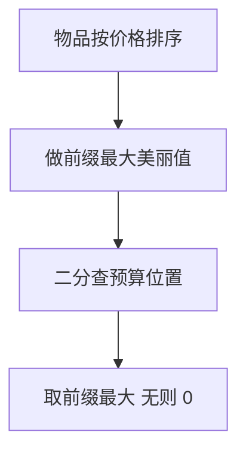

## Q
**LC 2070 每一个查询的最大美丽值**｜Medium

`items[i] = [price, beauty]`，`queries[j]` 是预算。对每个查询，求价格不超过预算的所有物品中最大的美丽值，没有则为 `0`。

## A
**一句话。** 物品按价格排序，做美丽值的前缀最大，每个查询二分找到价格不超过预算的最右物品，读它的前缀最大。



```python
def maximum_beauty(items, queries):
    items.sort()
    prices = [p for p, _ in items]
    best = []                              # 前缀最大美丽值
    cur = 0
    for _, b in items:
        cur = max(cur, b)
        best.append(cur)
    ans = []
    for q in queries:
        i = bisect_right(prices, q)        # 价格 <= q 的个数
        ans.append(best[i - 1] if i else 0)
    return ans
```

**复杂度。** 时间 `O((n + q) log n)`，空间 `O(n)`。

**易错点。**
- 二分后直接取 `beauty[i - 1]`：便宜的物品可能更美，要用前缀最大。
- `i == 0` 不特判：`best[-1]` 会取到末尾，应返回 `0`。

**追问。**
- 查询也排序可以去掉二分吗？：可以，查询升序时用一个指针推进，`O(n + q)`（排序之外）。

**同模式。** LC 1851 包含每个查询的最小区间、LC 1697 检查边长度限制的路径是否存在、LC 2300 咒语和药水的成功对数
