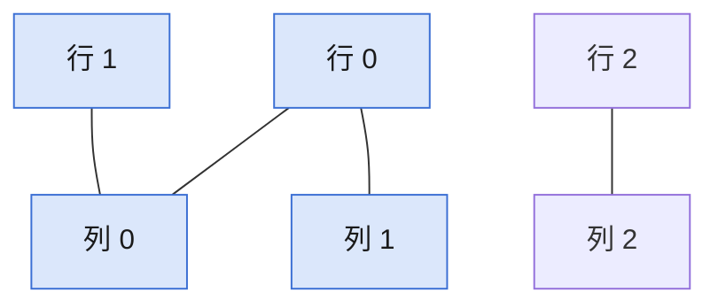

## Q
**LC 947 移除最多的同行或同列石头**｜Medium

二维平面上 `n` 块石头位于整数点，同一格至多一块。一块石头可被移除，当且仅当同行或同列还有别的石头（没被移除）。最多能移除多少块石头？

## A
**一句话。** 把石头按同行同列连成连通块，每块都能被删到只剩一块，所以答案是 `n - 连通块数`；用并查集把「行」和「列」本身当结点合并。

**图解。** 一块石头 `(r, c)` 就是行结点 `r` 与列结点 `c` 之间的一条边；石头同行同列自然落到同一个连通块。



```python
def remove_stones(stones):
    fa = {}
    def find(x):
        fa.setdefault(x, x)
        if fa[x] != x:
            fa[x] = find(fa[x])
        return fa[x]
    for r, c in stones:
        fa[find(r)] = find(~c)   # ~c 为负数，避免行列编号冲突
    return len(stones) - len({find(x) for x in list(fa)})
```

**复杂度。** 时间 `O(n α(n))`，空间 `O(n)`。

**易错点。**
- 行号和列号共用同一数字空间：行 `3` 与列 `3` 会被错误合并，列要取反或加偏移。
- 数连通块用 `len(fa)`：要数不同的根，不是结点个数。

**追问。**
- 为什么每块能删到只剩一块？：对连通块做 DFS 生成树，从叶子往上删，每次删的都是还有邻居的石头。
- 不用并查集呢？：对石头建图，同行同列互为邻居，DFS 数连通块，但建边是 `O(n^2)`。

**同模式。** LC 684 冗余连接（Redundant Connection）、LC 721 账户合并、LC 1202 交换字符串中的元素、LC 128 最长连续序列
