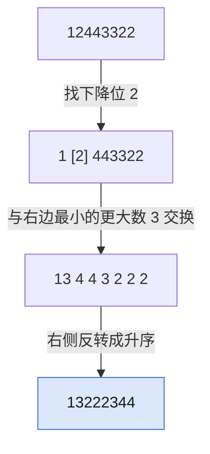

## Q
**LC 556 下一个更大元素 III**｜Medium

给正整数 `n`，返回用 `n` 的数位重新排列后比 `n` 大的最小 32 位整数；没有或超出 32 位整数范围则返回 `-1`。

## A
**一句话。** 就是下一个排列：从右往左找第一个下降的位置 `i`，从右边挑比它大的最小数与它交换，再把 `i` 右边升序排好。

**图解。** `12443322`：下降位是 `2`（下标 1），换成右边比它大的最小数 `3`，右边反转成升序，得 `13222344`。



```python
def next_greater_element(n):
    d = list(str(n))
    i = len(d) - 2
    while i >= 0 and d[i] >= d[i + 1]:   # 从右找第一个下降
        i -= 1
    if i < 0:
        return -1                        # 已是最大排列
    j = len(d) - 1
    while d[j] <= d[i]:                  # 右边比 d[i] 大的最小者
        j -= 1
    d[i], d[j] = d[j], d[i]
    d[i + 1:] = d[i + 1:][::-1]          # 后缀本是降序，反转成升序
    res = int(''.join(d))
    return res if res < 2**31 else -1
```

**复杂度。** 时间 `O(log n)`，空间 `O(log n)`。

**易错点。**
- 下降判断用 `>`：相等的数位不算下降，要 `>=` 继续向左。
- 交换后不处理后缀：后缀必须变成最小排列（升序），否则不是「最小的更大数」。
- 忘了 32 位上限：结果超过 `2³¹ - 1` 要返回 `-1`。

**追问。**
- 为什么后缀是降序？：`i` 是从右起第一个下降位，右边已经是非升序，反转即得升序。
- 想求上一个排列呢？：条件反过来，找第一个上升位。

**同模式。** LC 31 下一个排列、LC 670 最大交换、LC 738 单调递增的数字、LC 60 排列序列
